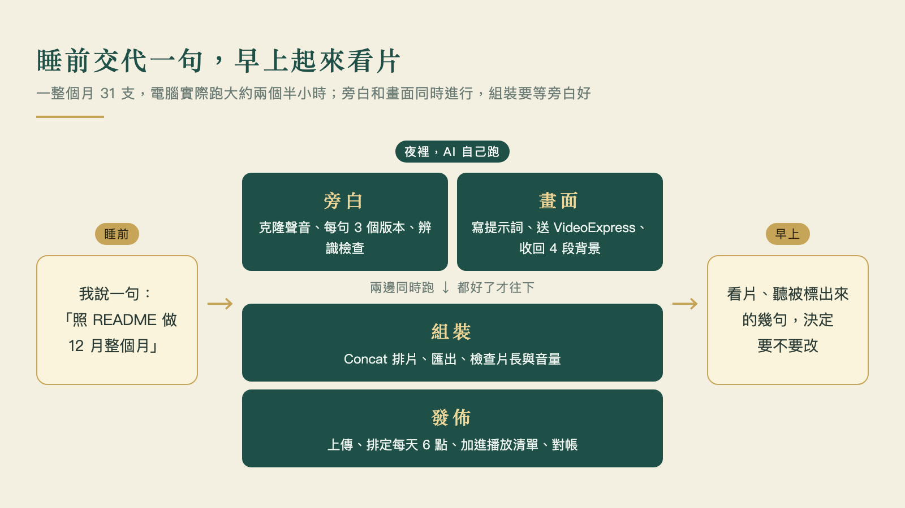
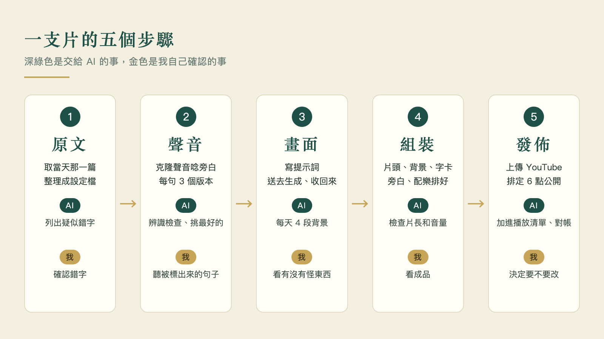
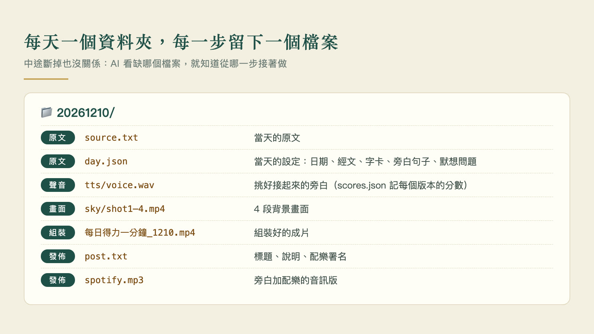

> 每日得力一分鐘影片：[每日得力一分鐘11月2號](https://www.youtube.com/shorts/SJAVWffar80)（[每日得力一分鐘11月 播放清單](https://www.youtube.com/playlist?list=PLOdL7Tk4xq5M)，每天更新）

今年我將母親留下來的文稿，重新整理後，透過 AI 工具，製作了包括每天一個「每日得力一分鐘」的影音小短片，短片中的聲音是我母親的聲音，影像也是自動產生的，很多人好奇這是怎麼做出來的，所以我將整個製作過程寫了以下的教學分享，希望對大家有幫助。

*同一個版型，每個月換一種片頭植物和背景（成片實際畫面）*

## 實作成果摘要

- 從 2026 年 10 月 1 日到 2027 年 1 月 31 日，每天一支，一共 123 支，全部已經上稿或排定發佈時間。
- 每支 56 到 86 秒，大多在 76 秒左右。
- YouTube 每天早上 6 點公開；同一份聲音也上 Spotify 和 Apple Podcasts。
- 現在流程已經順了，所以我常常是睡覺前交代 AI 一次做 30 集，早上起來就都好了 XD
- 一整個月 31 支，我的蘋果電腦（二手 MacBook Pro，M3 Max）實際跑的時間大約兩個半小時。
- 我主要花費的時間在「看」：確認原稿是否有錯字或語意要調整的地方、看背景畫面有沒有怪東西、聽被製作出來的旁白和影片有沒有奇怪的地方。

*一個晚上怎麼跑：旁白和畫面同時進行，都好了才組裝、發佈*

## 一支片怎麼來的

*五個步驟裡，哪些交給 AI、哪些我自己確認*

1. **原文**：從書稿取當天那一篇。AI 把它整理成當天的設定檔：日期、經文出處、要放上畫面的字、旁白的句子、最後的默想問題。原稿看起來有錯字的地方，它會列成一張表給我確認，不會自己改變原本的內容。
2. **聲音**：用母親過去的錄音當參考，參考音檔不用長，大概兩三段，各 15 秒左右就夠。我是在自己的電腦上用開源的 Qwen3-TTS 克隆，現在克隆的效果比一年前好很多。每句產生 3 個版本，再用語音辨識檢查字有沒有唸對，挑最好的接起來（辨識先用 Groq 免費額度的 Whisper large-v3，額度用完改在本機用 mlx-whisper，模型是 mlx-community/whisper-large-v3-turbo）。
3. **畫面**：每個月一種聖經植物當片頭（例如 12 月聖誕紅、1 月梅花），背景是天空、水面或冬天的晨光，用 [VideoExpress.ai](https://paykstrt.com/50942/180754) 生成（影像生成軟體平台，我有買終身版，美金 150 元左右，功能比不上 Seedance、Kling，但勝在影片製作不用額外扣點數花錢，可以無限測試與製作，性價比不錯）。
4. **組裝**：AI 驅動 Concat 把片頭、背景、經文字卡、旁白和配樂排好，字卡出現的時間跟著旁白走，直接匯出成片。
5. **發佈**：用 YouTube API 上傳、排定當天 6 點公開、加進當月的播放清單；音訊另外混音上 Spotify。

*十二個月的片頭植物：每個月一種聖經植物（1 月梅花、12 月聖誕紅是另外補的）*

## 用到的工具與花費

| 工作          | 我用的工具                                                                         | 花費                     |
| ----------- | ----------------------------------------------------------------------------- | ---------------------- |
| 工作 AI       | Claude Code，讀稿、設計版型給我選、排要唸的文字順序、決定每集配哪幾段小影片                                   | 訂閱制                    |
| 小影片         | [VideoExpress.ai](https://paykstrt.com/50942/180754)，由 AI 操作網頁自動送出與收回         | 終身版約 150 美元，之後生成不用另外花錢 |
| 聲音          | Qwen3-TTS，在自己電腦上跑，可以 Clone 聲音；唸得對不對用 Whisper 檢查（Groq 免費額度，用完改本機 mlx-whisper）  | 免費                     |
| 配樂          | 6 首 CC BY 授權的鋼琴與氛圍曲，依日期輪播、每支自動署名；想讓音樂對上畫面時，改用自己寫的作曲小程式，以 SoundFont 離線渲染成純樂器配樂 | 免費                     |
| 組裝          | [Concat](https://github.com/jub0t/concat)，免費開源工具，由 AI 驅動它排片與匯出，非常好用           | 免費                     |
| 主持人講話（需要才用） | [TalkingPhotos.ai](https://paykstrt.com/52357/180754)，同樣由 AI 操作網頁             | 終身版約 80 美元，之後生成不用另外花錢  |

看起來有一點複雜，但整條流程都能交給 AI 跑完，中間可以不用管，我只在最後看成品有沒有問題。

[VideoExpress.ai](https://paykstrt.com/50942/180754) 和 [TalkingPhotos.ai](https://paykstrt.com/52357/180754) 是同一家公司的產品，選它們的原因很單純：**我懶，也不想花大錢**。

它們的功能比 Seedance、Kling 這類服務弱，但夠我用，買斷之後就省下各種 AI 影片的生成費用。我另一個節目「編年式讀經」裡的主持人，就是 TalkingPhotos 做出來的。用 ChatGPT、Gemini 等 AI 工具，或是前面提到的軟體也能做影片，但做影片這些的花費相對高，每天都要製作就有點傷；當然在自己電腦上跑影片生成也可以，但是這需要很好的硬體，我也沒有，哈哈。

## 哪些交給 AI，哪些是我

| 交給 AI              | 我自己確認                   |
| ------------------ | ----------------------- |
| 把原稿整理成每天要使用的架構     | 決定節目內容什麼樣子（版型、字型、片頭片尾）  |
| 產生旁白、檢查有沒有唸錯或漏句    | 挑合適的聲音參考段落，決定聽起來的感覺     |
| 寫背景畫面的提示詞、送去生成、收回來 | 例如植物要畫對（聖經裡的芥菜不是我們吃的芥菜） |
| 組裝、檢查片長和音量         | 確認原稿錯字、聽被標出來的那幾句        |
| 上傳、排程、對帳有沒有漏       | 看完片決定要不要改               |

自動化省下的是重複的手工，判斷還是得自己做，責任不能推諉 XD

## 換一個節目要多久

流程調順之後，換一個新節目並不慢，一集大約抓 15 到 20 分鐘，一個小時可以做 3 到 4 集。

節目要做得快又好，有兩個主要的因素很重要：

- **稿子規劃得好**。所謂規劃得好，除了內容外，還包括哪些內容要唸、哪些只放在畫面上、經文出處是什麼，稿子裡都標好了，AI 讀完就能直接排。
- **配樂與視覺有想法**。雖然 AI 可以給出搭配的建議，但若是自己有比較清楚的想法，AI 搭配起來就會省很多時間，包括配樂有沒有人聲、風格等等。

當然，前期規劃與調教會比較需要時間，版型、聲音像不像、字卡怎麼斷行，都是一次一次看片改出來的，但只要這些苦工做好，後面就比較可以放心讓 AI 全自動執行。

## 想自己做的話

### 第一步：先跑一支影片就對了

將我這篇文章直接給你的 AI 工具，讓它幫你規劃一個適合你的流程，大概就可以執行了。

假如你有買 [VideoExpress.ai](https://paykstrt.com/50942/180754)，他們官方有一些工作流程放在 GitHub（[github.com/ai-playbooks](https://github.com/ai-playbooks)）。我比較習慣在終端機工具中（[CMUX](https://cmux.com/zh-TW) 是我最常用的工具，免費開源） 裡使用 Claude Code（其他 AI 工具的用法應該類似），在瀏覽器登入 VideoExpress 網站，把官方 Workflow 裡的 system prompt 交給 AI Agent，就能從一個想法做出一支片。

這一段我之前拍過一支教學片，也可以參考看看：
[How to use AI tools (such as Claude) with VideoExpress to create videos.](https://www.youtube.com/watch?v=EMB1GK34YcU)

規劃是需要的，但有時候也不用想太多、想得太完整，因為有了實作的影片之後，往往會給你更多的靈感，所以我覺得先踏出第一步是很重要的。

### 第二步：寫一份給 AI 看的 README，把「一次」變成「每天」

這是整件事真正的關鍵，而且不需要寫程式。

我的節目資料夾裡有一份 README，寫著這個節目長什麼樣子、每天要做哪幾步、每一步要留下什麼檔案，每次開工我只跟 Claude Code 說一句：

> 照 README 做 12 月整個月

它就讀 README 照做，做完一批，它會把這次新踩到的問題和解法寫回 README，下一個月就不會再犯。四個月下來，這份 README 就是這個節目的全部經驗。

README 裡最重要的是這幾段：

- **節目規格**：比例、片長、片頭片尾、字型、配樂。
- **給 AI 的規則**：原稿有疑問要問我、過程要留下必要的檔案、判斷不了就停下來問我。
- **每天的資料夾**：每一步做完產生哪個檔案。中途斷掉時，AI 看缺哪個檔案，就知道從哪一步接著做。
- **一次做一整個月**：哪些事可以同時跑（旁白和畫面），哪些要等（組裝要等旁白好）。
- **已做過**：每一批踩到的問題，這段會越寫越符合你的實際狀況。

*我的 12 月 10 日資料夾：每一步做完留下一個檔案*

我把自己的 README 去掉個人資料，整理成一份範本，可以直接下載改成你的節目：[每日節目 README 範本](/downloads/daily-show-readme-template.md)

範本裡沒有附程式。每一步需要的小程式，請 Claude Code 照 README 幫你寫，它寫完放在同一個資料夾，之後每天都能重複用。

### 第三步：換掉你想換的零件

官方流程全部在 VideoExpress 網站裡完成。以下是我照自己的需要換掉的環節，你可以挑需要的換：

| 環節  | 官方做法            | 我換成                                       | 為什麼換                 | 要先準備                                     |
| --- | --------------- | ----------------------------------------- | -------------------- | ---------------------------------------- |
| 聲音  | CloneVoice      | Qwen3-TTS，在自己電腦上克隆                        | 效果和速度都很理想，還不用另外付費    | 一台電腦（Apple Silicon 機型會比較順）、一段乾淨的參考錄音     |
| 配樂  | 自己找音樂           | CC BY 曲子依日期輪播；需要對上畫面時用程式作曲、SoundFont 離線渲染 | 不用每支挑歌，也不用另外付費       | 幾首授權清楚的曲子（記下署名方式）；程式作曲另需一個 SoundFont 音色檔 |
| 組裝  | VideoExpress 內建 | Concat                                    | 字卡、字型、轉場等之後還能再依照需要調整 | Concat 工具軟體                              |
| 發佈  | 手動上傳            | YouTube API 排程、Spotify 後台                 | 可依照需要全自動化上架          | Google Cloud 專案與 YouTube API 授權          |
| 錯字  | 人工一句一句聽         | 字詞對照表自動比對                                 | 不用每支重聽               | 不用，對照表放在節目資料夾                            |

換零件的方式都一樣：跟 Claude Code 說你要換什麼，請它改 README 裡那一步，並寫好需要的小程式。

字詞對照表滿重要的。國字有很多破音字，AI 有時候唸不準（例如「姪兒」）；字型裡沒有的字（例如古典字型裡的「祂」），還有語音辨識常聽錯但其實唸對的詞，都可以記在一個檔案裡，產生旁白和字卡前先自動換字，檢查時已知的誤聽也不再報。我的對照表現在記了 90 多條，每次要我親自聽的地方越來越少。

### 幾個提醒

- **克隆聲音要有授權**。千萬不要亂使用別人的聲音，我用的是自己或是母親的聲音，頻道說明裡交代了授權；YouTube 上傳時要勾選「合成內容」。
- **配樂也要授權**。我用的是 CC BY 授權的曲子，每支的說明欄都會自動加上署名。也可以在本機電腦上自己製作：我另外寫了一支作曲小程式，把畫面事件的秒數寫成清單，程式編曲後用 SoundFont 離線渲染成純樂器配樂，音樂就能對上畫面。
- **AI 一定要有適合的權限**。本機克隆聲音、組裝、上傳排程都要在自己電腦上跑，所以要用 Claude Code 這種能操作電腦的 AI，只在網頁裡的聊天機器人做不到，也因為它真的能動你電腦裡的檔案和登入中的帳號，權限要開到哪裡，使用者要明白自己的風險。

## 相關工具整理

| 工具                                                                          | 用途                                     | 費用                       |
| --------------------------------------------------------------------------- | -------------------------------------- | ------------------------ |
| [Claude Code](https://claude.com/claude-code)                               | 工作 AI，能操作電腦，整條流程由它串起來                  | 訂閱制                      |
| [CMUX](https://cmux.com/zh-TW)                                              | 終端機，同時開好幾個 AI 工作視窗                     | 免費開源                     |
| [VideoExpress.ai](https://paykstrt.com/50942/180754)                        | 生成背景小影片                                | 終身版約 150 美元              |
| [TalkingPhotos.ai](https://paykstrt.com/52357/180754)                       | 讓照片裡的主持人開口講話                           | 終身版約 80 美元               |
| [VideoExpress 官方工作流程](https://github.com/ai-playbooks)                      | 官方放在 GitHub 的 Workflow 與 system prompt | 免費                       |
| [Qwen3-TTS](https://github.com/QwenLM/Qwen3-TTS)                            | 本機克隆聲音、產生旁白                            | 免費開源                     |
| [mlx-whisper](https://github.com/ml-explore/mlx-examples/tree/main/whisper) | 本機語音辨識，檢查旁白有沒有唸對                       | 免費開源                     |
| [Groq](https://groq.com)                                                    | 雲端的 Whisper 語音辨識                       | 有免費額度                    |
| [Concat](https://github.com/jub0t/concat)                                   | 影片組裝與匯出，AI 可以直接驅動                      | 免費開源                     |
| YouTube Data API                                                            | 上傳、排程、加進播放清單                           | 免費（要自己開 Google Cloud 專案） |

## 我的相關頻道，歡迎訂閱、點讚、小鈴鐺 XD

- YouTube [Jacob Mei](https://www.youtube.com/@jacobmeiTW)：聖經相關，包含[每日得力一分鐘](https://www.youtube.com/playlist?list=PLOdL7Tk4xq5M)、[編年式讀經](https://www.youtube.com/playlist?list=PL9Wnikl0M81yQTDYO03iD3FPKladZJ6bN)、[穿越聖經時代](https://www.youtube.com/playlist?list=PLbeYmaJdz79U)
- YouTube [NotoriousLab](https://www.youtube.com/@JacobMei)：科技、金融與時事解說
- Podcast「小梅子的讀經靈修」：[Spotify](https://open.spotify.com/show/49zF19uCIvZT8o0YHVjCyu)、[Apple Podcasts](https://podcasts.apple.com/tw/podcast/id6826452415)

## 最後

我不是領域專家，這套流程也還在一邊做一邊改，祝大家都做出自己適合的影音短片 :)

<small>VideoExpress 和 TalkingPhotos 是我真的有在使用的軟體工具，透過我的推薦連結購買，我可以分到一點點的推廣費 XD</small>
