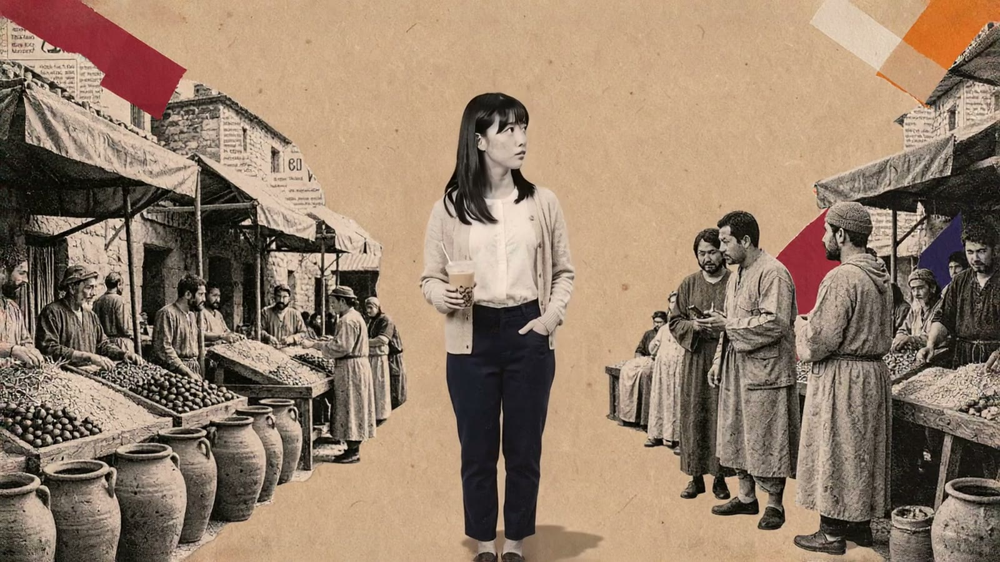
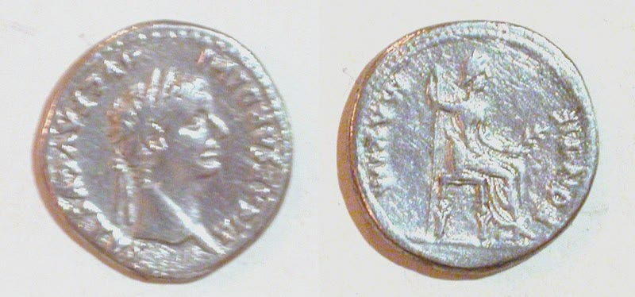
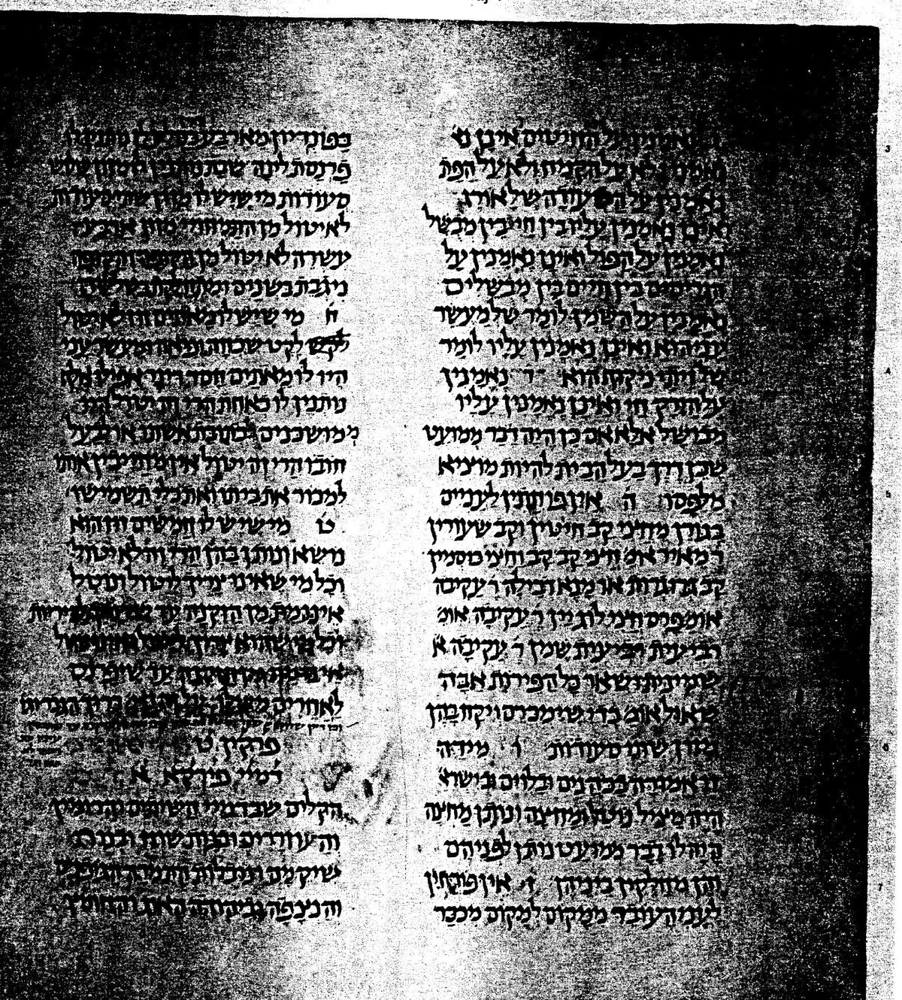
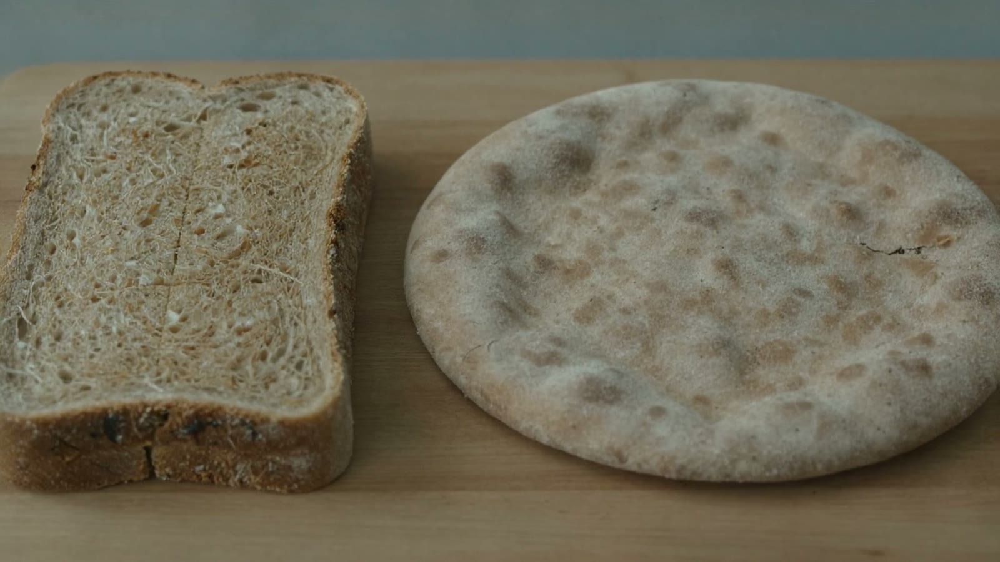
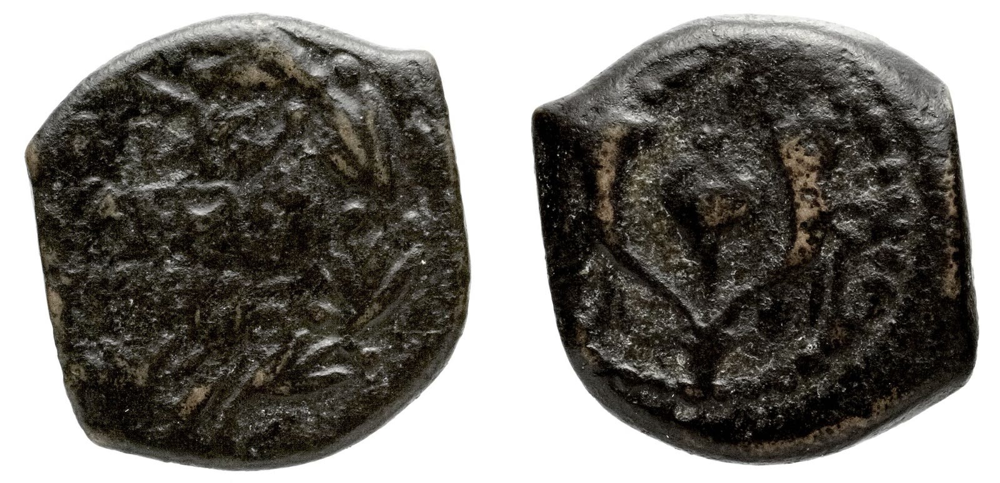
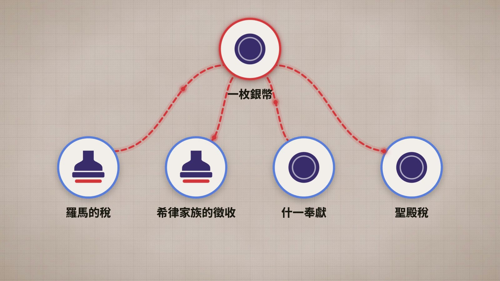

> 這篇也有影片版：[一杯珍奶，在耶穌時代能買什麼？｜穿越聖經時代 EP1](https://youtu.be/Qn4j-CvI-rY)（[穿越聖經時代 播放清單](https://www.youtube.com/playlist?list=PLbeYmaJdz79U)，每週二更新）

阿華今年剛出社會，在台北上班，領的是最低工資。明年（2027）起，這個數字是月薪 30,900 元、時薪 205 元 [1]。

下班經過手搖店，她點了一杯珍珠奶茶，半糖少冰，70 元。

用她的時薪算，這杯珍奶大約是 20 分鐘的工作，差不多是回完一封客訴信的時間。有點貴，但還在「今天辛苦了，獎勵一下」的範圍內。喝完，日子照過，房租照繳。

好，現在把阿華連同那杯珍奶，一起丟回兩千年前的加利利。

*情境重建，AI 生成*

那裡沒有手搖店，沒有悠遊卡，也沒有街口支付。大家用的是羅馬銀幣、地方銅幣，有時乾脆拿麥子、油或幫忙幹活來抵。阿華在市場上找不到珍奶，這不意外。比較有意思的問題是：

> 一個耶穌時代的工人，辛苦一整天換到一枚銀幣，他會不會捨得拿來「隨手買杯喝的」？

## 一、古代的人力銀行，叫做「市場」

新約裡最常出現的錢，是羅馬銀幣第納爾（denarius）。發工錢、買餅、借錢、繳稅、付旅館錢，到處都看得到它。

*第納爾銀幣（提庇留時期，公元 14–37 年）。照片：National Museums Liverpool / Portable Antiquities Scheme，[CC BY-SA 4.0](https://creativecommons.org/licenses/by-sa/4.0/)，經 Wikimedia Commons*

最有名的一段在馬太福音第 20 章，葡萄園的比喻：

> 「和工人講定一天一錢銀子，就打發他們進葡萄園去。」（馬太福音 20:2）

這裡的「一錢銀子」，一般認為就是一第納爾。也就是說，一個工人從清晨做到傍晚，換到一枚銀幣。

先打個預防針：這是比喻裡雙方講好的價錢，不代表當時每個地方、每一行都是這個行情。有學者就提醒，日薪會隨地區、季節和工作內容浮動，「一天一第納爾」比較像一個方便的比較基準 [2]。

那時候沒有 104，也沒有打工 App。想找零工，就是一早到市場站著，等老闆來挑人。比喻裡的主人從清晨一路找到下午，還看見「市上還有閒站的人」（馬太福音 20:3）。

*清晨的市場，工人靠牆等老闆來挑人。情境重建，AI 生成*

這些人是誰？研究這段比喻的學者認為，故事發生在葡萄收成季，正是最缺人手的時候；來排隊的，有些可能沒有自己的地，也有些是家裡有小塊田、想趁旺季多賺點現金的小農 [3]。不管是哪一種，日薪工人都屬於當時最沒保障的一群：今天沒被挑中，今天就沒收入，也沒有勞保可以申請。

所以那些站到下午還沒人要的人，心情大概不是「今天放假真爽」，比較像「再沒人來，今晚的飯就不知道在哪了」。

## 二、一第納爾，可以買多少麵包？

要感受一枚銀幣的分量，最直接的方法是拿去買吃的。

第一世紀的巴勒斯坦，麵包就是主食。一第納爾能換幾個？

有個常被拿來算的資料，在猶太律法彙編《米示拿》裡。它規定，給路過的窮人，至少要給一個「值一個 pondion 的麵包」，而且特別註明，這是以「小麥一 sela 買四細亞」的行情來算 [4]。照這套價格條件換算，一第納爾大約是 12 個小麥麵包。這不是當時固定的市價，但拿來感受一枚銀幣有多大，已經很夠用了。

*《米示拿》考夫曼抄本 MS Kaufmann A 50，Peah 8:7 所在的書頁（公有領域，經 Wikimedia Commons）*

另一條規定也很有意思：丈夫每週要給妻子的糧食，可以是兩卡布小麥，或四卡布大麥 [5]。同樣是養家，大麥要給到小麥的兩倍。兩種麥子在當時的餐桌上，顯然不是同一個等級。

十幾個麵包，聽起來好像還不錯？先別急著羨慕。這裡有兩個小細節。

### 1. 小麥是精緻路線，大麥是生存路線

麵包有時看得出一個人的口袋深淺。約瑟夫記載，耶路撒冷被羅馬軍隊圍城、鬧饑荒的時候，有錢人變賣家產換一點小麥，窮人換的是大麥，換到了還得躲起來偷偷吃 [6]。那是饑荒時的極端場面，不是平常日子；但也看得出來，吃小麥還是吃大麥，從來不只是口味問題。

現代人吃全麥是養生，那時候吃大麥，比較像是沒得選。

*左邊是現代的全麥吐司，右邊是粗硬的大麥餅。AI 生成*

這也讓「五餅二魚」多了一點味道。約翰福音 6:9 那個孩子帶來的，是「五個大麥餅」。一份樸素的午餐，可能也透露出，跟著耶穌跑的那群人裡，有不少是過著簡單日子的普通人。

### 2. 第納爾是大鈔，買麵包會被嫌

如果一第納爾可以買十幾個麵包，那它其實是一張「大鈔」。拿它去買一個麵包，大概就像拿千元鈔去超商買一顆茶葉蛋，店員會不會翻白眼，見仁見智。

日常的小買賣，用的多半是小銅幣，像是阿斯（as），或是寡婦投進奉獻箱的那種「小錢」（lepton）[7]。銀幣比較適合拿來結清工錢，或付一筆大開銷。

*猶太地區流通的 prutah 小銅幣，正反兩面（亞歷山大．楊內斯時期，公元前 103–76 年）。照片：Bibliothèque nationale de France（公有領域）*

## 三、錢還沒焐熱，就先被分完了

古代工人拿著那枚銀幣回家，路上大概已經在心裡排好清單：

- 麵包以外的柴火、鹽、油，運氣好的話再加條小魚
- 衣服要補，屋頂要修，農具或漁網用壞了要換

然後還有稅。

一個第一世紀的加利利人，可能要同時應付羅馬的稅、希律家族的稅，再加上什一奉獻和聖殿稅。稅到底有多重，學者到現在還在吵，有人認為壓得人喘不過氣，也有人認為沒那麼誇張 [8]。不過對一個收入看天吃飯的工人來說，羅馬要一份、地方政權要一份、宗教生活也要一份，辛苦賺來的錢，很可能還沒走到家就先被分掉一大塊。可以確定的是，古代沒有年底退稅這種好事。

*一枚銀幣，同時被羅馬的稅、希律家族的徵收、什一奉獻和聖殿稅拉走（不代表比例）*

所以古今最大的差別在這裡。

阿華買珍奶，是「要不要獎勵自己」的問題。今天不喝，房租照樣繳得出來。

古代的工人花錢，比較像是在玩一場預算很緊的模擬經營遊戲。扣掉稅、債、柴米油鹽，剩下能拿來「享受」的空間，大概跟珍奶裡的冰塊一樣少。隨手花掉一枚第納爾，可能就是幾天後鍋裡空空，或孩子生病時沒錢看病。

## 四、用這個基準，重新看看聖經裡的數字

有了「一天一第納爾」這個基準，再回頭看新約裡和錢有關的段落，會發現每個數字都很有畫面：

- **兩百第納爾的餅（馬可福音 6:37）：** 和合本寫「二十兩銀子」，和合本 2010 譯作「兩百個銀幣」，原文是兩百第納爾，也就是一個工人兩百個工作日的工錢。耶穌叫門徒「你們給他們吃吧」，門徒當場傻眼，完全可以理解。
- **寡婦的兩個小錢（路加福音 21:1–4）：** 兩個最小的銅板，丟進奉獻箱大概連聲音都沒有。耶穌卻特別點出，別人是從有餘的拿出來，她是「把她一切養生的都投上了」。兩個小錢，是她過日子要用的全部。
- **一萬他連得的債（馬太福音 18:24）：** 和合本譯作「一千萬銀子」，原文是一萬他連得。一他連得大約是六千第納爾。一萬他連得，用一天一第納爾來算，大概要不吃不喝、全年無休做十六萬年。比喻裡的國王把這筆債一筆勾銷，聽故事的人應該都倒抽一口氣。
- **二錢銀子（路加福音 10:35）：** 好撒瑪利亞人留給店主兩第納爾，大約兩天工錢，還交代「此外所費用的，我回來必還你」。用現代的話說，就是先墊兩天，多退少補，陌生人的醫藥費他包了。

## 五、那，一第納爾到底等於多少台幣？

這大概是最常被問的問題：既然一第納爾差不多是一天工資，那不就等於阿華的一天，1,640 元？

可惜沒那麼簡單。古代有沒有工作，看季節和收成；現代的薪水，有勞動契約和法律撐著。兩邊的花錢方式也完全不同：阿華的錢花在房租、捷運、手機月租和偶爾的一杯珍奶；古代工人的錢，大多花在麵包、粗布衣服和稅上。

所以這篇文章不打算給你一個「1 第納爾＝多少新台幣」的匯率。比起匯率，更有意思的是：同樣辛苦一天，兩個時代的人，各自能換到什麼樣的生活？

## 結語：珍奶喝完之前

回到阿華。

她站在手搖店門口，吸了一口珍奶，大概不會想到，兩千年前也有一群人，天還沒亮就到市場站著，等人來挑；傍晚握著一枚銀幣回家，一路盤算這枚銀幣要撐幾天。

*AI 生成*

他們沒有珍奶，煩惱倒是一點都不陌生：工作有沒有著落、錢夠不夠用、家人會不會生病。

讀聖經的時候，如果能偶爾想起這些人的日常，那些故事或許會離我們近一點。至少下次聽到「一天一錢」，你會知道，那是一個人站了一整天才換來的。

---

## 參考資料與附註

### 經文

- 馬太福音 20:1–16：葡萄園工人，講定一天一第納爾
- 馬可福音 6:37：兩百第納爾的餅（和合本作「二十兩銀子」）
- 馬太福音 18:24：一萬他連得的債（和合本作「一千萬銀子」）
- 路加福音 10:35：好撒瑪利亞人留下二錢銀子
- 路加福音 21:1–4：寡婦投兩個小錢
- 約翰福音 6:9：五個大麥餅

### 資料出處

1. 勞動部，〈最低工資連 11 漲！審議會決定自 116 年 1 月 1 日起，每月最低工資調升至 30,900 元，每小時最低工資調升至 205 元〉，2026 年 9 月 24 日；行政院，〈卓揆：最低工資連 11 年調漲〉，2026 年 10 月 1 日。
2. Halverson, Taylor. "Was the Denarius a Daily Wage? A Note on the Parable of the Two Debtors in Luke 7:40–43." *Interpreter* 36 (2020).
3. van Eck, Ernest, and John S. Kloppenborg. "An Unexpected Patron: A Social-Scientific and Realistic Reading of the Parable of the Vineyard Labourers (Mt 20:1–15)." *HTS Teologiese Studies/Theological Studies* 71, no. 1 (2015)，註 27。
4. 《米示拿》Peah 8:7。英譯註解：一 sela 等於 4 第納爾、48 pondion。
5. 《米示拿》Ketubot 5:8。
6. 約瑟夫（Josephus），《猶太戰記》5.427；轉引自 Weingarten, Susan. "Food in the Context of First-Century Galilee: The Mishnah and the So-Called 'Jesus Diet'." Oxford Symposium on Food and Cookery 2017 (2018)。
7. Reiser, Marius. "Numismatik und Neues Testament." *Biblica* 81 (2000): 457–488.
8. Harland, Philip A. "The Economy of First-Century Palestine: State of the Scholarly Discussion." In *Handbook of Early Christianity*, 2002.
延伸閱讀：Hamel, Gildas. *Poverty and Charity in Roman Palestine, First Three Centuries C.E.* Berkeley: University of California Press, 1990；Fiensy, David A., and Ralph K. Hawkins, eds. *The Galilean Economy in the Time of Jesus.* Atlanta: SBL, 2013；Sperber, Daniel. "Cost of Living in Roman Palestine." *JESHO* 8–13 (1965–1970)（多以公元 200 年以後的拉比文獻為材料，引用時要注意年代差）。

### 使用限制

- 台灣最低工資採 2027 年 1 月 1 日起的數字；珍奶 70 元是示例價格。
- 一第納爾約 12 個小麥麵包：依《米示拿》Peah 8:7 的價格條件推估（一 sela＝4 第納爾＝48 pondion，故一第納爾＝12 pondion，一個麵包值一 pondion）。《米示拿》約公元 200 年編成，晚於耶穌時代，此處只作購買力的參考，不視為第一世紀加利利的固定市價；實際價格會因地區、豐年荒年而不同。
- 大麥與小麥：Ketubot 5:8 只寫配給量（兩卡布小麥或四卡布大麥），本文不據此推算兩者的價格比。
- 十六萬年：一他連得約 6,000 第納爾，一萬他連得約 6,000 萬第納爾；以一天一第納爾、全年無休計，約 6,000 萬 ÷ 365 ≈ 16.4 萬年。
- 寡婦的兩個小錢：正文依路加福音 21:4 的說法，不推定那是她哪一天的飯錢。
