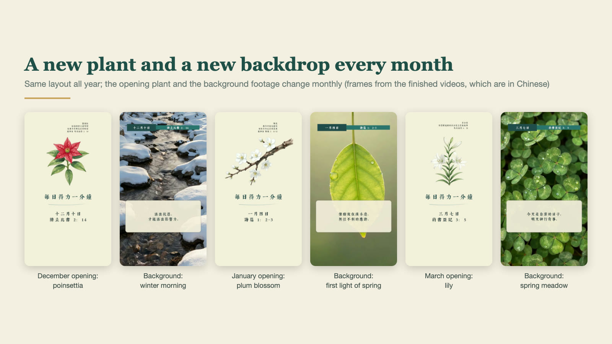
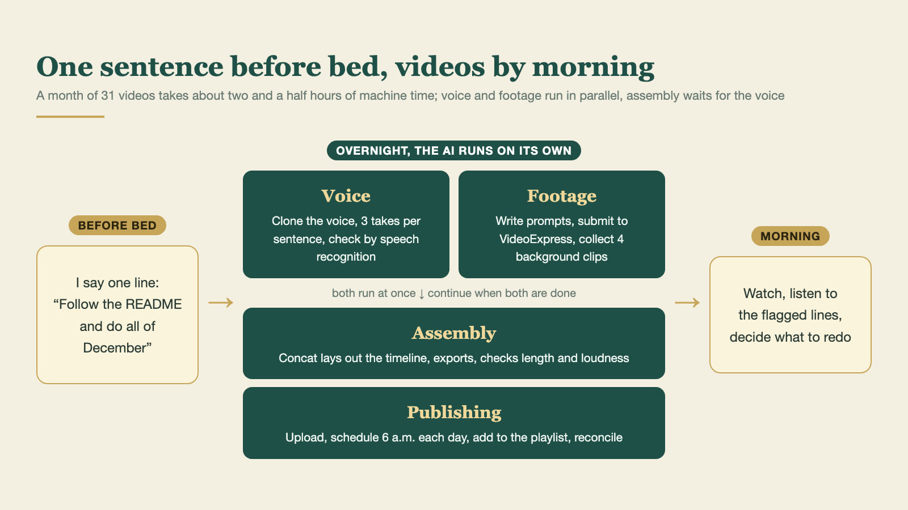
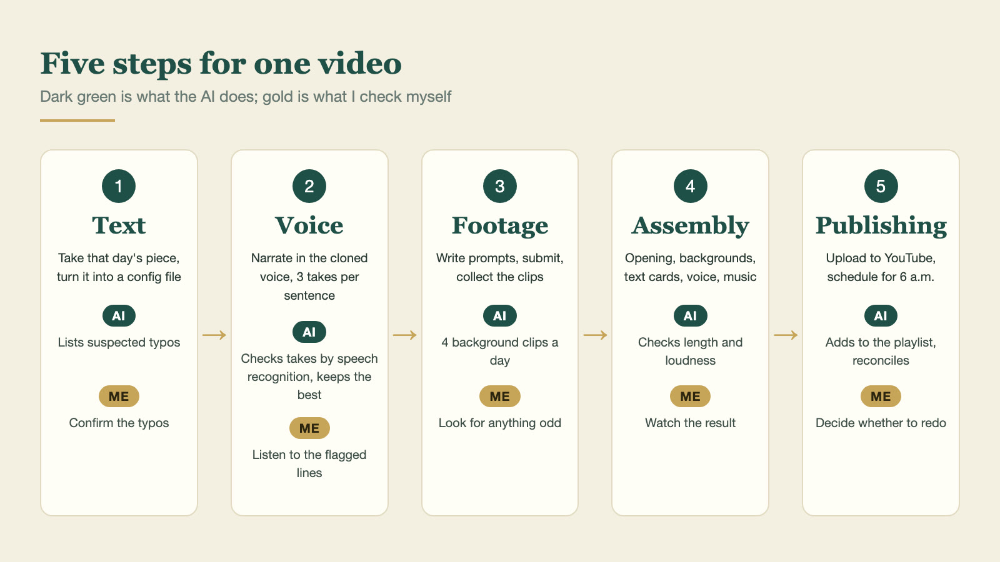
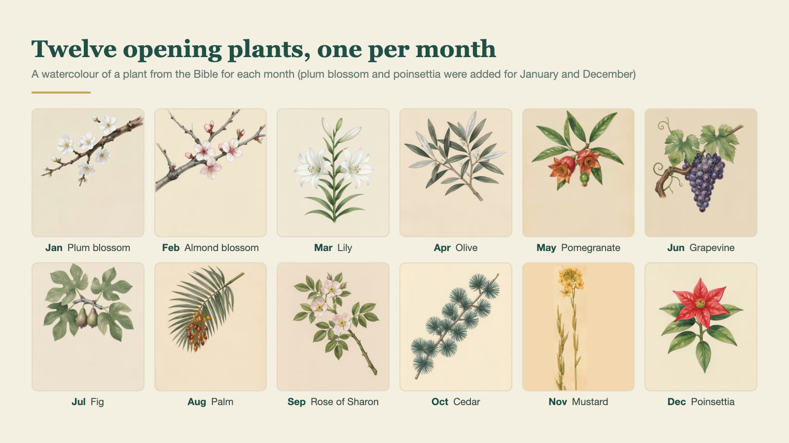
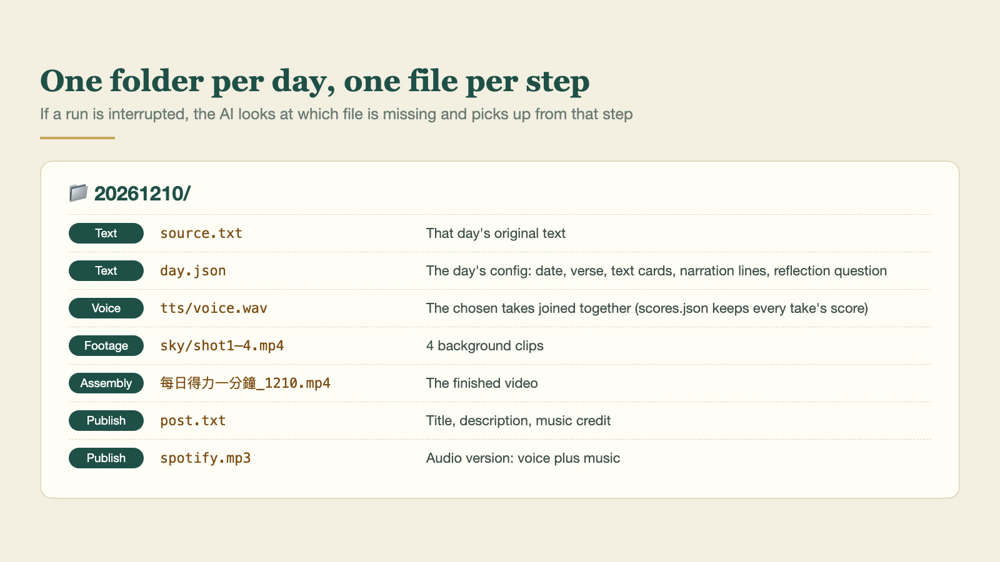

> Watch one: [One Minute of Daily Strength, November 2](https://www.youtube.com/shorts/SJAVWffar80) ([November playlist](https://www.youtube.com/playlist?list=PLOdL7Tk4xq5M), a new one every day). The videos are in Mandarin. 中文版：[每日得力一分鐘是怎麼每天自動做出來的](/blog/2026/1112-1jv4g2/)

This year I went back through the devotional writings my mother left behind and, with the help of AI tools, turned them into a short video for every day, called "One Minute of Daily Strength" (每日得力一分鐘). The voice in the videos is my mother's, and the footage is generated automatically. A lot of people have asked how it is done, so I wrote the whole process down here. I hope it is useful.

*Same layout all year; the opening plant and the background change every month (frames from the finished videos)*

## The results so far

- One video a day from October 1, 2026 to January 31, 2027: 123 in total, all uploaded or scheduled.
- Each runs 56 to 86 seconds, most of them around 76.
- They go public on YouTube at 6 a.m. every day; the same audio also goes to Spotify and Apple Podcasts.
- The process is smooth enough now that I usually ask the AI for 30 episodes before I go to bed, and they are all done when I get up.
- A month of 31 videos takes about two and a half hours of actual machine time on my Mac (a second-hand MacBook Pro, M3 Max).
- Most of my own time goes into looking: checking the source text for typos or wording that needs adjusting, checking the backgrounds for anything odd, and listening to the narration and the finished videos for anything strange.

*What a night looks like: voice and footage run in parallel, then assembly and publishing*

## How one video comes together

*The five steps, and which parts are the AI's and which are mine*

1. **Text**: take that day's piece from the manuscript. The AI turns it into a config file for the day: the date, the Bible reference, the words that go on screen, the narration sentences and the closing reflection question. Where the source looks like it has a typo, it lists the spots in a table for me to confirm. It never changes the original on its own.
2. **Voice**: old recordings of my mother are the reference. They do not need to be long: two or three clips of about 15 seconds each are enough. I clone the voice on my own computer with the open-source Qwen3-TTS; cloning is much better than it was a year ago. Each sentence is generated three times, speech recognition checks whether every word was read correctly, and the best takes are joined together. (Recognition uses Whisper large-v3 on Groq's free tier first; when the quota runs out it switches to mlx-whisper on the Mac, with the mlx-community/whisper-large-v3-turbo model.)
3. **Footage**: each month opens with a plant from the Bible (poinsettia for December and plum blossom for January are my own additions), and the backgrounds are sky, water or winter morning light, generated with [VideoExpress.ai](https://paykstrt.com/50942/180754). It is an AI video platform; I bought the lifetime plan for about US$150. It is not as capable as Seedance or Kling, but generating video costs no extra credits, so I can test and produce as much as I like. Good value.
4. **Assembly**: the AI drives Concat to lay out the opening, the backgrounds, the verse cards, the narration and the music. The cards follow the timing of the narration, and the video is exported directly.
5. **Publishing**: upload through the YouTube API, schedule for 6 a.m. that day, add to the month's playlist. The audio is mixed separately for Spotify.

*Twelve opening plants, one from the Bible for each month (plum blossom and poinsettia were added for January and December)*

## Tools and what they cost

| Job | What I use | Cost |
| --- | --- | --- |
| The working AI | Claude Code: reads the manuscript, designs layouts for me to choose from, orders the text to be read, decides which clips go with each episode | Subscription |
| Short clips | [VideoExpress.ai](https://paykstrt.com/50942/180754), with the AI operating the website to submit and collect | Lifetime plan about US$150, no further cost per video |
| Voice | Qwen3-TTS on my own computer, which can clone a voice; Whisper checks the reading (Groq's free tier, then mlx-whisper locally) | Free |
| Music | Six CC BY piano and ambient tracks, rotated by date and credited automatically; when I want music that follows the picture, a small composing program of my own renders instrumental music offline with a SoundFont | Free |
| Assembly | [Concat](https://github.com/jub0t/concat), a free open-source editor the AI can drive to lay out and export. Very handy | Free |
| A talking host (only when needed) | [TalkingPhotos.ai](https://paykstrt.com/52357/180754), also operated by the AI through the website | Lifetime plan about US$80, no further cost per video |

It looks a little complicated, but the AI can run the whole pipeline without me in the middle. I only check the finished videos at the end.

[VideoExpress.ai](https://paykstrt.com/50942/180754) and [TalkingPhotos.ai](https://paykstrt.com/52357/180754) come from the same company. My reason for choosing them is simple: **I am lazy, and I do not want to spend a lot of money**.

They are weaker than services like Seedance or Kling, but good enough for me, and once you have bought them you stop paying for every generated video. The host in my other series, a chronological read-through of the Bible, is made with TalkingPhotos. You can also make videos with ChatGPT, Gemini or the services above, but video generation is comparatively expensive, and that hurts when you publish every day. Running a video model on your own machine works too, but it needs very good hardware, which I do not have.

## What the AI does, what I do

| The AI | Me |
| --- | --- |
| Turns the manuscript into the daily structure | Decide what the show looks like (layout, fonts, opening and ending) |
| Generates the narration, checks for misreadings and dropped sentences | Pick suitable voice reference clips and decide how it should sound |
| Writes the background prompts, submits them, collects the clips | Make sure, for example, that the plant is the right one (the mustard of the Bible is not the mustard we eat) |
| Assembles, checks length and loudness | Confirm the typos, listen to the flagged sentences |
| Uploads, schedules, checks that nothing is missing | Watch the result and decide whether to redo it |

Automation takes away the repetitive handwork. The judgment is still mine, and so is the responsibility.

## How long does a new show take?

Once the process is tuned, starting a different show is not slow. Allow 15 to 20 minutes per episode, so three or four episodes an hour.

Two things matter most if you want it fast and good:

- **A well-planned script.** Beyond the content itself, that means the script already marks what is read aloud, what only appears on screen, and where each verse comes from. Then the AI can lay it out straight after reading it.
- **Your own ideas about music and visuals.** The AI can suggest pairings, but if you already know fairly clearly what you want (whether the music has vocals, what style), it saves a lot of time.

The early planning and tuning do take time. The layout, how close the voice sounds, how the text cards break across lines: all of that came from watching and revising again and again. Once that groundwork is done, you can trust the AI to run on its own.

## If you want to build your own

### Step 1: just make one video

Give this article to your AI tool and ask it to plan a workflow that fits you. That is roughly enough to get going.

If you have bought [VideoExpress.ai](https://paykstrt.com/50942/180754), the company publishes some official workflows on GitHub ([github.com/ai-playbooks](https://github.com/ai-playbooks)). I like to run Claude Code inside a terminal ([cmux](https://cmux.com) is the one I use most; free and open source), and other AI tools should work in a similar way. Log in to VideoExpress in the browser, hand the system prompt from the official workflow to the AI agent, and it can take you from an idea to a finished video.

I made a tutorial video about this part earlier:
[How to use AI tools (such as Claude) with VideoExpress to create videos.](https://www.youtube.com/watch?v=EMB1GK34YcU)

Planning is needed, but do not overthink it or try to make it complete. A real video in your hands usually gives you more ideas, so taking the first step matters most.

### Step 2: write a README for the AI, and turn "once" into "every day"

This is the real key to the whole thing, and it needs no programming.

My show's folder has a README that says what the show looks like, which steps to do each day, and which file each step must leave behind. Every time I start, I tell Claude Code one sentence:

> Follow the README and do all of December

It reads the README and does it. After each batch it writes the new problems it ran into, and how they were solved, back into the README, so the next month does not repeat them. After four months, that README holds everything this show has learned.

The most important sections are:

- **Show spec**: aspect ratio, length, opening and ending, fonts, music.
- **Rules for the AI**: ask me when the source is unclear, leave the necessary files along the way, stop and ask when it cannot decide.
- **The daily folder**: which file each step produces. If a run is interrupted, the AI sees which file is missing and knows where to resume.
- **Doing a whole month at once**: what can run at the same time (voice and footage) and what has to wait (assembly waits for the voice).
- **Done so far**: the problems each batch ran into. The longer this gets, the better it fits your real situation.

*My folder for December 10: every step leaves a file behind*

I removed my personal details from my own README and made a template you can download and adapt to your show: [Daily show README template](/downloads/daily-show-readme-template-en.md) (also in [Chinese](/downloads/daily-show-readme-template.md)).

The template contains no code. Ask Claude Code to write the small programs each step needs, following the README. It keeps them in the same folder, and they are reused every day after that.

### Step 3: swap the parts you want to swap

The official workflow does everything inside the VideoExpress website. These are the parts I replaced for my own needs; pick the ones you want:

| Part | Official way | What I use | Why | What you need first |
| --- | --- | --- | --- | --- |
| Voice | CloneVoice | Qwen3-TTS, cloned on my own computer | Quality and speed are both very good, and there is nothing more to pay | A computer (Apple Silicon runs it more smoothly) and a clean reference recording |
| Music | Find your own | CC BY tracks rotated by date; when it has to follow the picture, music composed by program and rendered offline with a SoundFont | No choosing a track for every video, nothing more to pay | A few tracks with clear licences (note how to credit them); composing by program also needs a SoundFont file |
| Assembly | Built into VideoExpress | Concat | Text cards, fonts and transitions can still be adjusted afterwards | The Concat app |
| Publishing | Upload by hand | YouTube API scheduling, Spotify's dashboard | Publishing can be fully automated | A Google Cloud project and YouTube API authorisation |
| Misreadings | Listen to every sentence | A word list checked automatically | No need to re-listen to every video | Nothing; the list lives in the show folder |

Swapping works the same way every time: tell Claude Code what you want to replace, and ask it to change that step in the README and write whatever small program is needed.

The word list matters a lot. Chinese has many characters with more than one reading, and the AI sometimes gets them wrong. Characters missing from a font, and words that speech recognition often mishears although they were read correctly, can all go into one file. They are substituted automatically before the narration and text cards are generated, and known mishearings are no longer reported. My list has more than 90 entries now, and there is less and less I have to listen to myself.

### A few reminders

- **Get permission before cloning a voice.** Never use someone else's voice without it. I use my own voice and my mother's, the channel description states the authorisation, and on YouTube you must tick "altered or synthetic content" when uploading.
- **Music needs a licence too.** I use CC BY tracks, and the credit is added to every description automatically. You can also make your own on your computer: I wrote a small composing program that takes a list of the moments when things happen on screen, arranges the music, and renders it offline with a SoundFont, so the music follows the picture.
- **The AI needs the right permissions.** Voice cloning, assembly and scheduled uploads all run on your own computer, so you need an AI that can operate a computer, like Claude Code. A chatbot that lives in a web page cannot do this. Because it really can touch the files on your machine and the accounts you are logged in to, how much access you give it is a risk you need to understand.

## Tools at a glance

| Tool | What it is for | Cost |
| --- | --- | --- |
| [Claude Code](https://claude.com/claude-code) | The working AI; it can operate the computer and ties the whole pipeline together | Subscription |
| [cmux](https://cmux.com) | A terminal for running several AI sessions side by side | Free, open source |
| [VideoExpress.ai](https://paykstrt.com/50942/180754) | Generates the background clips | Lifetime plan about US$150 |
| [TalkingPhotos.ai](https://paykstrt.com/52357/180754) | Makes the host in a photo speak | Lifetime plan about US$80 |
| [VideoExpress official workflows](https://github.com/ai-playbooks) | The workflows and system prompts the company publishes on GitHub | Free |
| [Qwen3-TTS](https://github.com/QwenLM/Qwen3-TTS) | Clones a voice and generates the narration locally | Free, open source |
| [mlx-whisper](https://github.com/ml-explore/mlx-examples/tree/main/whisper) | Local speech recognition, to check the narration was read correctly | Free, open source |
| [Groq](https://groq.com) | Whisper speech recognition in the cloud | Free tier available |
| [Concat](https://github.com/jub0t/concat) | Video assembly and export, driven directly by the AI | Free, open source |
| YouTube Data API | Upload, schedule, add to playlists | Free (you set up your own Google Cloud project) |

## My channels

- YouTube [Jacob Mei](https://www.youtube.com/@jacobmeiTW): Bible-related, including [One Minute of Daily Strength](https://www.youtube.com/playlist?list=PLOdL7Tk4xq5M), [Reading the Bible chronologically](https://www.youtube.com/playlist?list=PL9Wnikl0M81yQTDYO03iD3FPKladZJ6bN) and [Back to Bible Times](https://www.youtube.com/playlist?list=PLbeYmaJdz79U) (all in Mandarin)
- YouTube [NotoriousLab](https://www.youtube.com/@JacobMei): technology, finance and current affairs
- Podcast 小梅子的讀經靈修: [Spotify](https://open.spotify.com/show/49zF19uCIvZT8o0YHVjCyu), [Apple Podcasts](https://podcasts.apple.com/tw/podcast/id6826452415)

Subscriptions and likes are very welcome.

## Finally

I am not an expert in this field, and the pipeline is still changing as I go. I hope you end up making short videos that suit you.

<small>VideoExpress and TalkingPhotos are tools I really use. If you buy through my referral links, I receive a small commission.</small>
