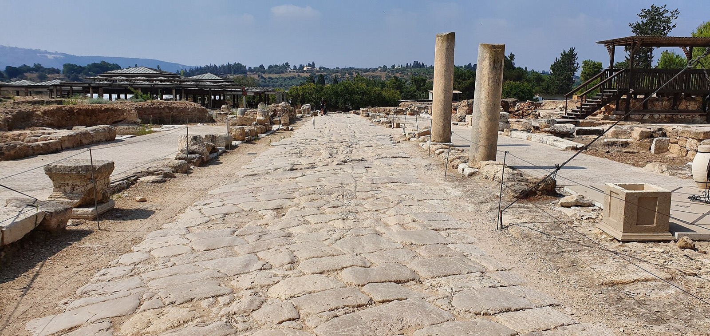

> 這篇也有影片版：[你以為彼得是個窮漁夫？他放下的比你想像的多！｜穿越聖經時代 EP2](https://youtu.be/LjCb9Le6Vps)（[穿越聖經時代 播放清單](https://www.youtube.com/playlist?list=PLbeYmaJdz79U)，每週二更新）

在上一集裡，我們用一杯珍奶和一塊錢第納爾（Denarius），算出了耶穌時代日薪工人的生存極限：一般人辛辛苦苦工作一天，換來的一枚銀幣，得在麵包、油、稅捐與明天的飯碗之間拼命打結。

但如果你以為聖經新約時代的人全都領著一樣的微薄日薪，那就太小看兩千年前地中海世界的貧富差距了。

如果我們觀察第一世紀的以色列職場，以基層工人的一天一枚第納爾（1 Denarius/天）作為暫時的參考標準，就會發現這場職場生態的落差，簡直比喜馬拉雅山還要陡峭。從加利利海邊迎風破浪的漁夫，到拿著鐵錘的木匠；從獨立接案的使徒，到販賣紫色商品的女商人；從帝國體制的軍官，到富裕的稅吏長與宗教菁英，如果用這個標準來衡量，這些人的收入、資產與生存狀態到底差在哪裡？

所以，我們真的能算出類似彼得這樣的漁夫，一個月賺多少錢嗎？答案其實沒這麼簡單～

## 一、 漁夫彼得：擁有生產工具的自營漁夫

很多人以為彼得是個赤腳坐在湖邊補網的窮光蛋，但依據學者約翰·克洛彭堡（John S. Kloppenborg）等人在加利利漁業經濟史研究中指出，經文給我們的畫面其實不太一樣。彼得和他的合作夥伴雅各與約翰，參與的是一門需要船隻、網具與資金的商業活動（參見路加福音 5 章 1 至 11 節）。

*情境重建，AI 生成*

- **資產配置：** 他們不是單純靠出賣勞力領日薪的散工，而是有船、有網。馬可福音也提到，雅各和約翰的父親西庇太還雇有工人（參見馬可福音 1 章 20 節）。這表示他們具備生產工具，也需要承擔設備維護與營運成本。
    
- **收入與風險：** 商業捕魚的收益是浮動的。在魚訊好的季節，漁獲能帶來不錯的收入；但在淡季、遭遇暴風雨，或者必須面對交易成本與稅費時，這門生意隨時有虧損的風險。
    
- **相對座標：** 現代一點說，彼得比較像是自備生財器具、承擔營運風險的自營漁夫，而不是每天等人來雇用的臨時工。這不代表他是加利利海的低調有錢人，但他確實身處一個有資本投入、有市場波動的商業鏈條中。

## 二、 木匠約瑟：靠血汗和技術賺錢的技術工

在傳統印象中，約瑟和耶穌身為技術工匠（tekton），似乎有一門好手藝。

- **真實的勞動：** 依據大衛·費恩西（David A. Fiensy）的研究，tekton 這個詞不只是現代意義的木工，也涵蓋石匠或建築相關工匠。當時加利利有農村房屋、公共建築與城市建設的需求，例如離拿撒勒不遠、被希律安提帕選為首都的西弗里斯城正在重建，這類手藝人有機會靠技術接活。不過，我們沒有足夠資料知道約瑟實際領多少日薪，也不能確定他是否曾參與西弗里斯城的工程。
    
- **相對座標：** 他們比純粹出賣勞力的零工多了一點技術溢價，但這依然是一份標準的血汗勞力財。案子不是天天有，手藝人也不代表能財富自由；對要養活一大群孩子的約瑟來說，只要碰上景氣不好或全家生病停工，收入一樣會陷入斷炊。

*西弗里斯（Zippori）遺址的主街。鋪石路面是羅馬時期所建，年代晚於耶穌時代。照片：Yair Haklai，[CC BY-SA 4.0](https://creativecommons.org/licenses/by-sa/4.0/)，經 Wikimedia Commons（[原檔](https://commons.wikimedia.org/wiki/File:Cardo-Zippori.jpg)，已縮小）*

## 三、 保羅與呂底亞：自由工作者 vs. 商業女商人

新約世界裡，除了傳統勞動者，也出現了兩種截然不同的商業身影：

### 1. 使徒保羅：自食其力的技術型自由工作者

保羅一邊傳道，一邊靠自己的手藝維持生活，他與亞居拉、百基拉同業，從事帳棚製作相關工作（參見使徒行傳 18 章 3 節）。這類工作需要專業技能，不是隨便找個人就能取代，如果用現代職場來比喻，保羅比較像是有一技之長、能靠專業工作維持生活的自由工作者，只是他的工作地點跟著宣教旅程移動，收入來源不一定穩定。
### 2. 呂底亞：販賣紫色商品的女商人

在腓立比信主的呂底亞，是一位來自推雅推喇、專門販賣紫色商品的女商人（參見使徒行傳 16 章 14 節），在古代，紫色商品通常與較高的社會地位和消費能力有關，她當時人在腓立比，而且有能力接待保羅一行人（參見使徒行傳 16 章 15、40 節）。我們無法確定她究竟是染料商、布料商還是經營更完整的貿易生意，但至少可以看出她不是只能靠一天工錢過生活的人，代表了新約中少見的女性商業人物。

*古代紫色染料的來源之一：染料骨螺（Bolinus brandaris）的殼。照片：H. Zell，[CC BY-SA 3.0](https://creativecommons.org/licenses/by-sa/3.0/)，經 Wikimedia Commons（[原檔](https://commons.wikimedia.org/wiki/File:Bolinus_brandaris_01.jpg)，已裁切、縮小）*

## 四、 睚魯與邊緣人：社群有地位的人物與土地邊緣人

在社會結構中，還有不同位置的群體：

- **會堂管事睚魯：** 睚魯是管會堂的人（參見馬可福音 5 章 22 節、路加福音 8 章 41 節），這個身分讓他在地方猶太社群中具有一定地位，也可能有一定的社會資源。但經文沒有告訴我們他的財產或土地有多少，所以不能直接把他歸類為富裕中產。但我們可以知道，古代社會除了有錢人和窮人，還有一群靠著社群職分、宗教角色和地方關係取得一定地位的人。
    
- **佃農與牧羊人：** 在第一世紀的加利利，土地、債務和租佃關係是影響農民生存的重要因素，部分農民可能因債務或收成不佳而失去土地，轉而成為佃農或農業工人。此外，牧羊人在聖經裡常被浪漫化，但現實生活並不輕鬆，許多人是受雇替別人看管羊群的基層勞動者；後期的猶太拉比文獻雖然討論過部分牧羊人和稅吏的作證限制，但不能直接推論第一世紀所有牧羊人都沒有作證資格。

## 五、 百夫長：軍事管理階層的鐵飯碗

新約裡常出現的羅馬百夫長（例如迦百農那位蓋會堂的百夫長，參見路加福音 7 章 1 至 10 節），在經濟上是另一種指標。

- **薪資與體制：** 依據歷史學家對羅馬軍餉的考證，羅馬職業軍隊的中堅指揮官享有相當優渥且穩定的國家薪俸，第一世紀軍團百夫長的年薪可能達到數千第納爾，遠高於一般士兵。不過，路加福音提到的迦百農百夫長身處希律安提帕統治的加利利，其部隊的具體編制與薪俸不能直接套用羅馬軍團的標準。
    
- **相對座標：** 如果用現代職場比喻，百夫長至少不是每天早上站在市場等人來雇用的臨時工，而是有組織、有職權、有制度性收入的軍事管理階層。

## 六、 稅吏長撒該與祭司菁英：掌握制度資源的權貴

如果說前面幾位還在日常開銷裡打滾，那稅吏長與耶路撒冷的宗教菁英，則處在完全不同的經濟層次。

- **稅吏長撒該：** 撒該是耶利哥的稅吏長，而且路加福音直接告訴我們他是個有錢人（參見路加福音 19 章 2 節）。當時的稅務徵收制度相當複雜，部分稅務會透過承包或地方徵收人員執行，這也為徵收過度或藉機牟利留下空間，撒該的職位和財富讓他與一般日薪工完全不在同一個層次。
    
- **高階祭司菁英：** 依據學者埃德·桑德斯（E. P. Sanders）對聖殿經濟的研究，耶路撒冷聖殿是宗教、財政與商業活動交織的中心，祭司菁英能夠從聖殿制度與資源分配中獲益，坐擁龐大的社會與經濟資源。

*情境重建，AI 生成*

## 七、 貨幣單位的震撼：從第納爾到他連得的巨大鴻溝

為了理解古代的職場薪資落差，我們必須看懂當時的貨幣跨度。

前面提到，基層勞工辛勤工作一天的酬勞是 1 Denarius，但在聖經的比喻中，經常出現更高階的單位：他連得（Talent）。依據道格拉斯·奧克曼（Douglas E. Oakman）對古代貨幣的研究，這兩個單位之間的差距極大：

- 1 Talent（他連得）大約相當於 6,000 Denarii（第納爾）。
    
- 如果一個普通工人每天賺 1 枚第納爾，必須工作 6,000 天才賺得到。如果一年工作 300 天，這相當於整整 20 年的時間。

當我們回頭看馬太福音第 18 章中那個被免去一萬他連得巨債的比喻時，就會懂耶穌講的比喻對當時的人來說有多震撼：一萬他連得是一個普通人幾輩子也賺不到的天文數字。耶穌藉此讓聽眾感受到，這筆債根本大到不可能靠個人償還。

## 八、 壓垮基層的壓力：多重負擔與債務地獄

在第一世紀的加利利與猶太地，老百姓面對的不是只有一種稅。

羅馬帝國有直接稅，地方政權也會透過關卡、交易和其他方式徵收收入；猶太人還有什一奉獻與年度聖殿稅等宗教義務，這些負擔不是每個人都以相同方式繳納，但對收入不穩定的農夫、漁夫和日薪工來說，當收成不好、漁獲減少，或家中有人生病時，這些固定或半固定的負擔就可能讓家庭陷入困境。

更麻煩的是債務。一旦無法償還，土地可能被出售或失去，原本的自耕農也可能被迫成為佃農，甚至只能靠零工維生，這不是個人失敗，而是整個結構性風險的體現。

## 九、 自問自答的真相：彼得一個月到底賺多少錢？

我們一開始問了一個很多人好奇的問題：你的月薪，彼得要賺幾個月？

答案是：**其實無法簡單估算出來。**

因為在兩千年前的加利利海邊，彼得沒有領月薪，沒有勞健保，也沒有薪資條，他今天網子撒下去，可能滿載而歸；明天風浪大作，可能一無所獲。我們知道他有船有網，也參與漁業生意，但我們沒有辦法可靠地算出他一年到底賺多少錢，更不能直接說他比日薪工多賺幾倍。
## 十、 收入與生存型態對照表

不過，我們還是可以初步地了解一些重要的事實：古代的貧富差距，不只是每天多賺幾枚銀幣的差別，而是有人只能出賣勞力賺取日薪，有人則擁有生產工具、承擔市場風險，也有人掌握著商業資源與制度權力，下面是一個參考的對照表。

| **人物／職業**     | **經濟位置** | **主要收入或資源**  | **主要風險**   |
| ------------- | -------- | ------------ | ---------- |
| **日薪工人**      | 基層勞動者    | 每日工資         | 沒有工作就沒有收入  |
| **佃農**        | 農業勞動者    | 農作物收成或租佃所得   | 收成、租金、債務   |
| **牧羊人**       | 受雇畜牧者    | 牧養工作或牲畜收益    | 天候、牲畜損失、雇主 |
| **約瑟／tekton** | 技術工匠     | 專業手藝與工作報酬    | 案源與工作量     |
| **彼得等漁夫**     | 生產型自營者   | 漁獲銷售收入       | 漁獲、設備、交易成本 |
| **睚魯**        | 地方社群職分人物 | 職分與社群資源      | 資料不足，難以判斷  |
| **保羅**        | 技術工作者    | 手藝工作收入       | 工作地點與案源    |
| **呂底亞**       | 商業經營者    | 紫色商品交易       | 商品成本、市場與資金 |
| **百夫長**       | 軍事管理階層   | 軍職薪俸         | 軍職、政治與軍事變動 |
| **撒該**        | 地方稅務菁英   | 稅務職位及相關收入    | 政權與制度變動    |
| **高階祭司菁英**    | 宗教與政治菁英  | 聖殿制度、家族與社會資源 | 政治權力變動     |

## 結語：耶穌與你在同一張桌子旁相遇

當我們把上面這張經濟位置表攤開，就能更明白耶穌的餐桌為什麼總是讓人側目。

祂不只是用比喻談論貧富，而是直接坐進了這個被社會結構拉開差距的世界中間，祂與稅吏撒該吃飯，不代表認同稅吏的剝削行為；相反地，撒該在耶穌面前所作的財產承諾，讓人看見一個人的經濟行為也可以發生改變。祂與罪人同桌，則讓那些被社會排斥的人重新有機會被接納。

在一個用一枚第納爾就能量出整個人生壓力差的世界裡，耶穌用一張桌子，把原本被分開的人重新拉到一起，這或許才是新約經濟故事最刺眼、也最有力量的部分。

## 參考資料與文獻考證附註

### 一、新約經文背景

- 路加福音 5 章 1 至 11 節：彼得與夥伴的商業船隊與捕魚經濟背景
- 馬可福音 1 章 20 節 / 馬可福音 6 章 3 節：西庇太的雇工與耶穌身為 tekton 的勞動背景
- 使徒行傳 18 章 3 節：保羅的帳棚製作自由接案背景
- 使徒行傳 16 章 14 節：腓立比的紫色商品女商人呂底亞的商貿背景
- 路加福音 7 章 1 至 10 節：迦百農百夫長的軍事地位與條件
- 路加福音 19 章 2 節：耶利哥稅吏長撒該的財富背景
- 馬可福音 5 章 22 節、路加福音 8 章 41 節：會堂管事睚魯
- 馬太福音 18 章 24 節：一萬他連得巨債的比喻

### 二、學術研究與歷史經濟文獻

1. **Kloppenborg, John S.** “Jesus, Fishermen and Tax Collectors: Papyrology and the Construction of the Ancient Economy of Roman Palestine.”
2. **Fiensy, David A., and Ralph K. Hawkins, eds.** _The Galilean Economy in the Time of Jesus_. Atlanta: Society of Biblical Literature, 2013.
3. **Udoh, Fabian E.** _To Caesar What Is Caesar's: Tribute, Taxes, and Imperial Administration in Early Roman Palestine (63 B.C.E.–70 C.E.)_.
4. **Hamel, Gildas.** _Poverty and Charity in Roman Palestine: First Three Centuries C.E._ Berkeley: University of California Press, 1990.
5. **Oakman, Douglas E.** _Jesus and the Economic Questions of His Day_. Lewiston: Edwin Mellen Press, 1986.
6. **Keddie, Anthony.** _Class and Power in Roman Palestine: The Social Worlds of Early Judaism_. Cambridge University Press.
7. **Sanders, E. P.** _Judaism: Practice and Belief, 63 BCE–66 CE_. London: SCM Press, 1992.
