> 這篇也有影片版：[耶穌也吃地中海飲食？｜穿越聖經時代 EP3](https://youtu.be/iO1-Kfx3Yrk)（[穿越聖經時代 播放清單](https://www.youtube.com/playlist?list=PLbeYmaJdz79U)，每週二更新）

## 開場：阿華的橄欖油疑問

阿華最近很認真研究地中海飲食。

橄欖油、全穀物、魚、豆類、適量紅酒。她看著那些漂亮的圖片，心裡想：「原來古人吃得這麼健康，難怪能減脂、護心、抗發炎。」

然後她開始計算自己一天該吃多少克碳水、多少好油。

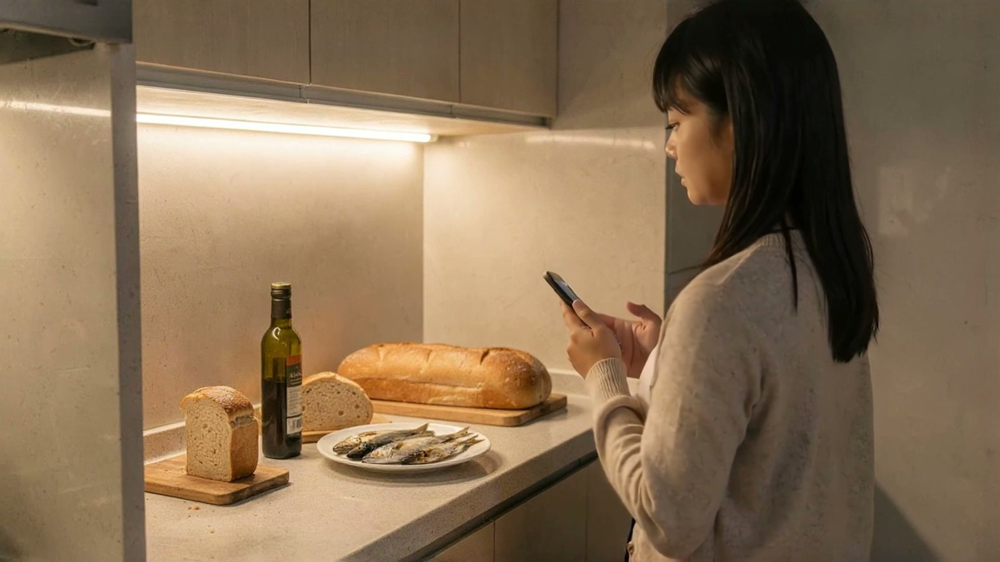*AI 生成*

可是，耶穌時代的人，真的是為了健康在吃這些嗎？

為什麼他們幾乎不吃豬肉？為什麼很多海鮮不能碰？這些規定跟健康有關嗎？

其實，第一世紀猶太家庭吃什麼，取決於土地給什麼、市場買得到什麼、家裡負擔得起什麼，以及律法允許什麼。

健康不是他們設計飲食的主要目的。而猶太潔淨律，就像一張看不見的過濾網，決定什麼食物能上桌，也影響誰能坐在一起吃飯。

今天，我們就跟著阿華，走進第一世紀加利利和猶太地的餐桌。

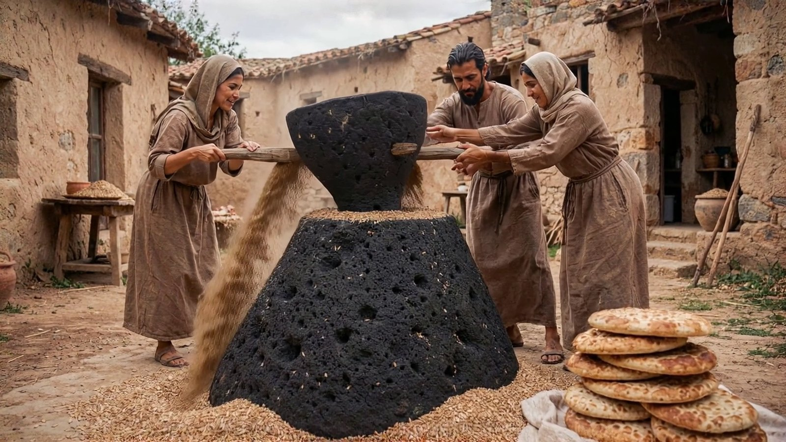*情境重建，AI 生成：照迦百農出土的石磨下扇，畫出它在使用中的樣子*

---

## 一、餐桌上到底有什麼？

先說結論：那不是「選擇型飲食」，而是「生存型飲食」。

普通家庭的日常其實很單純。

主食是大麥餅或小麥餅。經濟較拮据的人通常比較依賴大麥，條件好一點才有更多小麥。許多研究估算，穀物，尤其是麵包，可能提供一般人一半以上的熱量，部分地區和階層甚至更高。

不過，這不是每個家庭都一樣，會因地區、階級和季節而有差異。

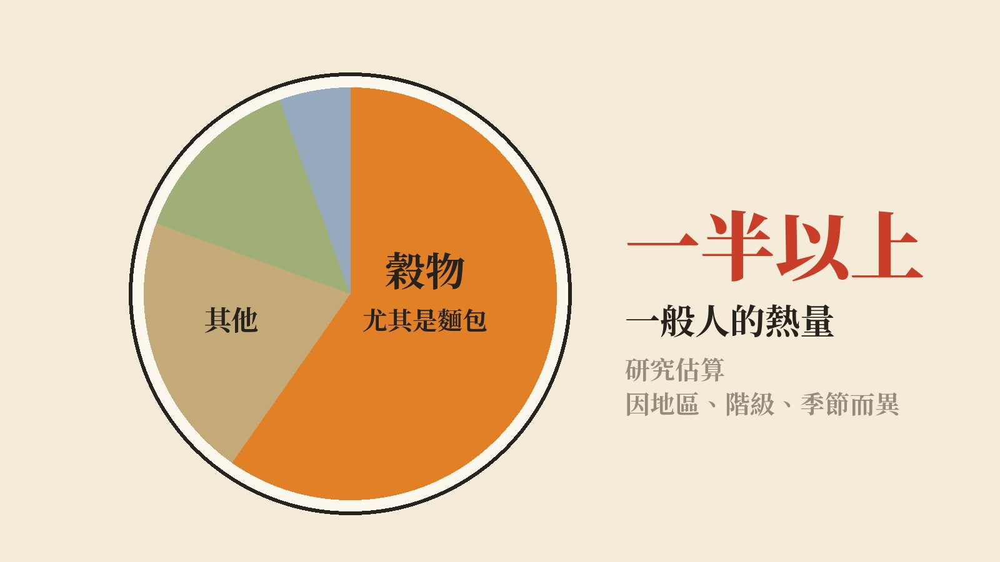*示意圖：研究估算，比例因地區、階級、季節而異*

油就是橄欖油，拌麵包、烹調食物，甚至點燈，都靠它。

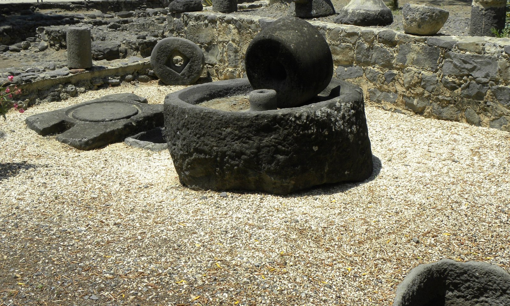*迦百農的羅馬時期榨油石臼。照片：Ian Scott，[CC BY-SA 2.0](https://creativecommons.org/licenses/by/2.0/)，經 Wikimedia Commons（[原檔](https://commons.wikimedia.org/wiki/File:Olive_processing_installation_at_Capernaum_(5825768989).jpg)，已縮小）*

蛋白質的日常來源則包括豆類：扁豆、蠶豆、鷹嘴豆，煮成一鍋厚厚的燉菜。

靠近加利利海的人，魚也是重要的蛋白質來源。例如當地的慈鯛科魚類、鯉科魚類，以及小型沙丁魚類。有些魚會曬乾或鹽漬保存，不必每天都靠新鮮漁獲。

至於羊肉、山羊肉，對一般家庭而言並不是天天上桌的食物，通常在節期、宴席或特殊場合比較有機會吃到。

蔬果就是當季的：無花果、葡萄、棗、石榴、洋蔥、蒜、韭菜、黃瓜和各種野菜。

飲料以水為主，葡萄酒也相當重要，尤其在宴席和節期。古代地中海世界常有葡萄酒加水飲用的習慣，但比例並不固定，也不是每個家庭都能經常喝酒。

那麼，吃這些東西要花多少錢？

我們前兩集提過，馬太福音二十章的葡萄園工人，一天工資是一枚第納爾（和合本譯作「一錢銀子」）。

這可以作為當時日薪工人的參照，但不是全民平均薪資。農民、漁夫、工匠和臨時雇工的收入都不一樣。

對依賴日薪維生的家庭來說，最大的壓力往往是收入不穩定。食物、稅賦和宗教奉獻，有些人還得付地租，都可能成為家庭經濟的負擔。

彼得這種有船有網的漁夫，至少擁有生產工具和取得收入的機會，但不代表沒有風險。漁獲不好、設備損壞、銷售不順，一樣會影響一家人的生活。

所以，當時很多人不是「吃得健康又有餘裕」，而是「想辦法讓一家人吃飽」。

這套飲食，是土地、季節和錢包共同形成的生存模式，不是現代人坐在冷氣房裡挑選的健康菜單。

---

## 二、潔淨律：一張看不見的過濾網

第一世紀的飲食，也不是土地有什麼就吃什麼那麼簡單。

猶太潔淨律像一道過濾網，決定什麼食物可以上桌、什麼不行，也影響人們對潔淨和社會關係的理解。

**第一層，是飲食律。**

主要規定出自《利未記》十一章和《申命記》十四章。

陸上動物要同時反芻、蹄分兩瓣，才符合規定。

牛、羊、山羊可以，豬和駱駝不行。兔子雖然看起來像在反芻，但不符合蹄分兩瓣的條件。

水中生物則必須有鰭有鱗（和合本譯作「有翅有鱗」）。一般符合條件的魚可以吃，蝦、蟹、貝類和鰻魚等則不符合規定。

血也不能吃，屠宰時必須依照規定放血處理。

至於「不可用山羊羔母的奶煮山羊羔」（申命記 14:21）這條律法，後來在猶太傳統中發展出更嚴格的肉奶分離規定。但不能把後來完整的猶太飲食規範，全部倒推到耶穌時代。

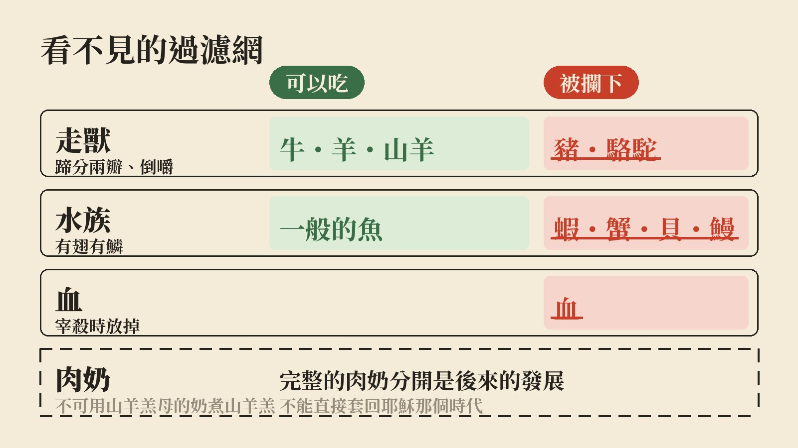*示意圖：飲食律的四層過濾；完整的肉奶分開是後來的發展*

**第二層，是禮儀潔淨。**

它不只管食物，也涉及人的身體狀態和接觸。

例如碰到死人、某些體液或患有特定皮膚病，都可能使人處於不潔的狀態，需要按照規定潔淨。

另外，部分猶太群體，特別是重視潔淨傳統的法利賽人，也會要求按照傳統進行飯前洗手儀式。

這不是摩西律法對所有人明文規定的日常洗手程序，而是當時發展出來的宗教傳統。

《馬可福音》第七章就記載，法利賽人質疑耶穌的門徒沒有按照傳統洗手便吃飯。

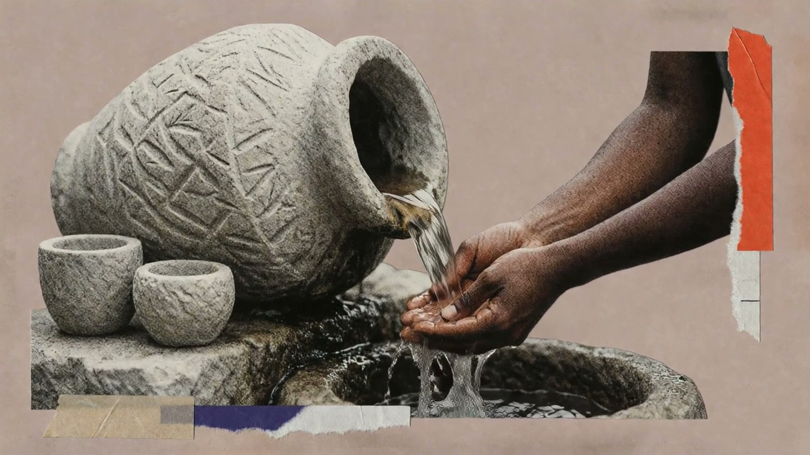*情境重建，AI 生成*

因此，豬肉在猶太飲食文化中幾乎被排除。考古研究也發現，第一世紀猶太聚落出土的動物骨骼中，豬骨比例通常很低。

這不是因為豬肉不健康，而是律法和猶太身份認同的問題。

海鮮也有選擇性。加利利海的魚是重要蛋白質來源，但許多我們今天覺得美味的蝦、蟹、貝類，卻不在允許的範圍內。

這也讓我們理解，為什麼魚在福音書的飲食場景中如此重要。

那麼，耶穌怎麼看這些規定？

《馬可福音》第七章記載，耶穌說：

「從外面進去的不能污穢人，惟有從裡面出來的乃能污穢人。」（馬可福音 7:15）

耶穌把人的內在道德潔淨，放在外在儀式之前。他挑戰人們把宗教傳統當成評斷別人的標準。

至於這段經文是否也代表飲食律本身被解除，則涉及不同的聖經詮釋。後來《使徒行傳》第十章彼得所看見的異象，以及第十五章初代教會對外邦人的討論，也讓這個問題有了更進一步的發展。

但有一件事很清楚：食物從來不只是營養。

它也是身份認同，是宗教實踐，有時甚至影響誰能放心地坐在同一張桌子旁。

耶穌常被批評「與稅吏和罪人一同吃飯」，正是因為他挑戰了當時人們對潔淨、身份和接納的既有想像。

---

## 三、迦拿婚宴：六百瓶酒是什麼概念？

《約翰福音》第二章的迦拿婚宴，是我們少數能具體看到大型宴會的場景。

猶太婚禮是家族和社區的重要事件，宴席可能持續數日。後期拉比文獻也記載了新婚慶祝七天的傳統，但不能因此認定第一世紀每場婚禮都固定舉行七天。

酒是婚宴的重要飲品。

對主人來說，酒不夠喝不只是少了一道飲料，也可能讓招待賓客的面子和榮譽受到影響。因為在當時的社會，款待客人是一件很重要的事。

結果，迦拿婚宴上真的出問題了：酒用完了。

耶穌把六口石缸的水變成酒。

《約翰福音》記載，每口石缸「可以盛兩三桶水」。這裡的「桶」其實是一種古代液體量器，一個約 39 公升。換算下來，每口大約75到115公升，六口合計約450到690公升。

換成現在750毫升的酒瓶，大約是600到920瓶！

這可不是主人臨時去巷口買幾瓶酒就能解決的問題。

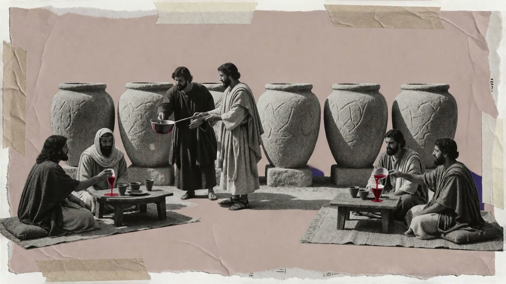*情境重建，AI 生成*

而且，這些石缸原本是猶太潔淨禮儀使用的器皿，經文特別提到這一點。

耶穌在這裡所行的神蹟，不只是讓婚宴有酒喝，更讓整場宴席的喜樂得以延續。管筵席的人甚至發現，主人竟然把好酒留到最後。

跟現代台灣喜宴比較，相同的是「不能讓客人沒東西吃喝」的好客精神，不同的是當時的婚宴可能連好幾天，親友和社區裡不少人都會參與。

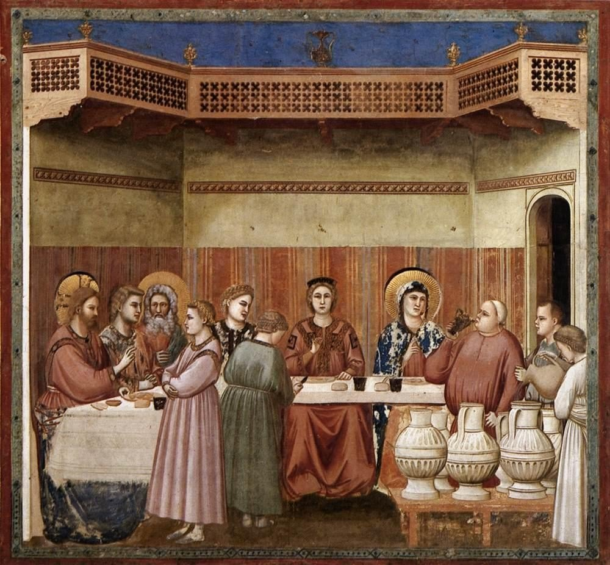*喬托〈迦拿的婚禮〉，約 1305 年，帕多瓦斯克羅維尼禮拜堂。公有領域，經 Wikimedia Commons（[原檔](https://commons.wikimedia.org/wiki/File:Giotto_di_Bondone_-_No._24_Scenes_from_the_Life_of_Christ_-_8._Marriage_at_Cana_-_WGA09202.jpg)，已縮小）*

- 古代婚宴可能持續數日；現代台灣婚宴通常集中在一個時段。
    
- 古代核心是酒、麵包、有能力才有的肉類，以及社區參與；現代則有多道熱菜、海鮮、甜點和敬酒文化。
    
- 古代酒不夠可能讓主人很沒面子；現代則可能變成菜不夠、服務不好，被客人抱怨。
    

而這六口石缸，也讓我們看到一個很有意思的畫面：耶穌把原本用於潔淨禮儀的水，變成了婚宴上的酒。

這可以引發關於潔淨、新時代和豐盛的神學聯想，也是約翰福音這段故事值得思考的地方。

---

## 四、他們怎麼招待人？

招待客人，在當時不是「有空才請客」，而是文化和宗教傳統中很重要的責任。

客人來了，可能先洗腳，因為路途遙遠、塵土很多；有時主人也會提供水、油，讓客人整理儀容。

這些在正式場合或較富裕的家庭中特別常見。

在較正式的宴席中，富裕家庭或有一定社會地位的人可能採斜躺的方式用餐，座位也有尊卑之分。主人會特別照顧重要客人。

但一般家庭日常吃飯，不一定都是這種姿勢。

最重要的是：同桌吃飯，往往不只是填飽肚子，也代表建立關係和接納。

接待旅人、分享食物，在舊約和第一世紀猶太社會都是重要的美德。

亞伯拉罕接待三個陌生人的故事，就是這種好客傳統的經典例子。

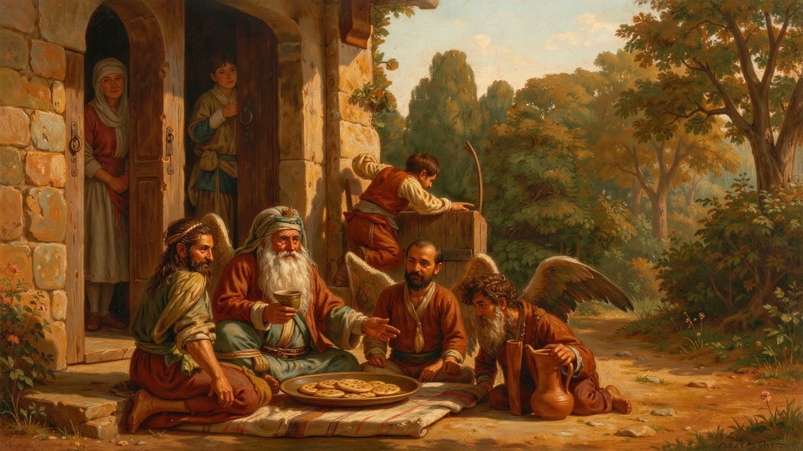*依林布蘭〈亞伯拉罕款待天使〉（1656 年蝕刻版畫，公有領域，[原檔](https://commons.wikimedia.org/wiki/File:Abraham_Entertaining_the_Angels_MET_DP814892.jpg)）重繪的彩色版，AI 生成*

但在當時，潔淨規範也可能影響人們能否放心地一起吃飯。

耶穌卻經常與稅吏、罪人和其他被社會看不起的人一起吃飯。

想像一下，在一個非常重視潔淨和身份的社會裡，有一個老師不斷邀請那些不受歡迎的人上桌，這會引起多少爭議？

耶穌的餐桌實踐，正是在這樣的社會環境裡，重新讓人思考什麼是真正的潔淨，以及誰值得被接納。

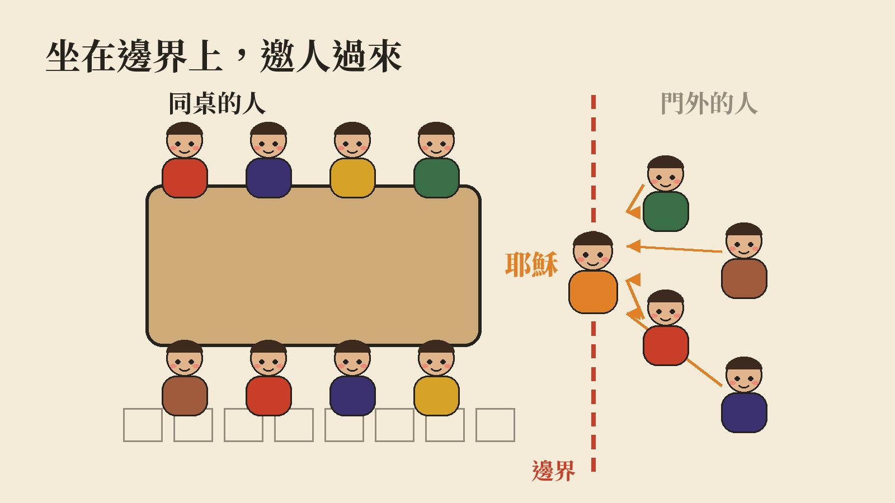*示意圖*

---

## 五、當時的地中海飲食，跟現在差在哪？

看到這裡，我們會發現，第一世紀猶太人的飲食，和現代地中海飲食確實有不少相似之處。

橄欖油、穀物、豆類、魚、蔬果，都是重要食材。

但兩者背後的生活條件和目的，差異很大。

|面向|第一世紀猶太餐桌|現代地中海飲食|
|---|---|---|
|動機|土地、季節、經濟、律法與生存|健康預防與生活選擇|
|主食|大麥、小麥與麵包，穀物熱量佔比高|強調全穀物，搭配蔬果與豆類|
|食物選擇|受季節、地區、階級限制|有冷藏、運輸與多樣選擇|
|宗教界線|有明確飲食律與潔淨規範|通常沒有宗教飲食邊界|
|食物加工|傳統研磨、醃漬、乾燥、發酵|兼有傳統食物與工業加工食品|
|糖分來源|蜂蜜、果實等天然甜味來源|天然糖與精製糖都容易取得|
|活動量|農業、漁業等體力勞動較多|許多現代工作型態較為久坐|

現代地中海飲食，是二十世紀中後期逐漸建立的健康飲食模式，有大量研究支持它對心血管健康等方面的益處。

但它不是第一世紀猶太餐桌的複製貼上。

古人以穀物作為主要熱量來源，現代地中海飲食則更強調全穀物、蔬果、豆類、橄欖油和魚類的均衡搭配，並減少紅肉與高度加工食品。

古人有明確的動物分類和飲食限制，現代地中海飲食則通常沒有這一層宗教規範。

古代有鹽漬魚、醃菜、乳酪、發酵食物，並不是沒有加工食品；只是沒有今天這種大量工業化食品和精製糖普及的環境。

還有一點很容易被浪漫化：古代飲食並不代表古人比較健康。

他們面對食物短缺、傳染病、高嬰兒死亡率和缺乏現代醫療等問題。古代農業和漁業社會需要大量體力勞動，日常能量消耗也與現代許多久坐工作者不同。

同樣的食物種類，放在不同的份量、活動量和生活環境中，健康結果也可能不同。

所以，如果我們從古代飲食中提取一些值得現代人參考的生活原則，而不是照抄古代菜單，可以得到幾個啟發：

- 少吃高度加工食品。
    
- 多吃本地、當季食材。
    
- 以植物性食物和全穀物為主。
    
- 魚類比紅肉更常作為蛋白質來源。
    
- 吃飯時有人陪伴，而不是邊滑手機邊吃。
    

這些是現代人可以參考的生活方式，不代表第一世紀猶太人有意識地在執行一套健康計畫。

健康是可能的結果，不是他們設計飲食的主要動機。

---

## 結語：耶穌坐在邊界上

耶穌時代的人沒有在減脂、沒有在算熱量，也沒有在追求抗發炎。

他們只是在有限的資源和潔淨規範裡，盡力讓家人吃飽、讓客人受到歡迎、讓節期充滿喜樂。

而耶穌最常出現的場景之一，正是吃飯。

在稅吏家裡、在法利賽人家裡、在海邊烤魚、在最後的晚餐。

一張桌子，可以分開人，也可以把人重新連結在一起。

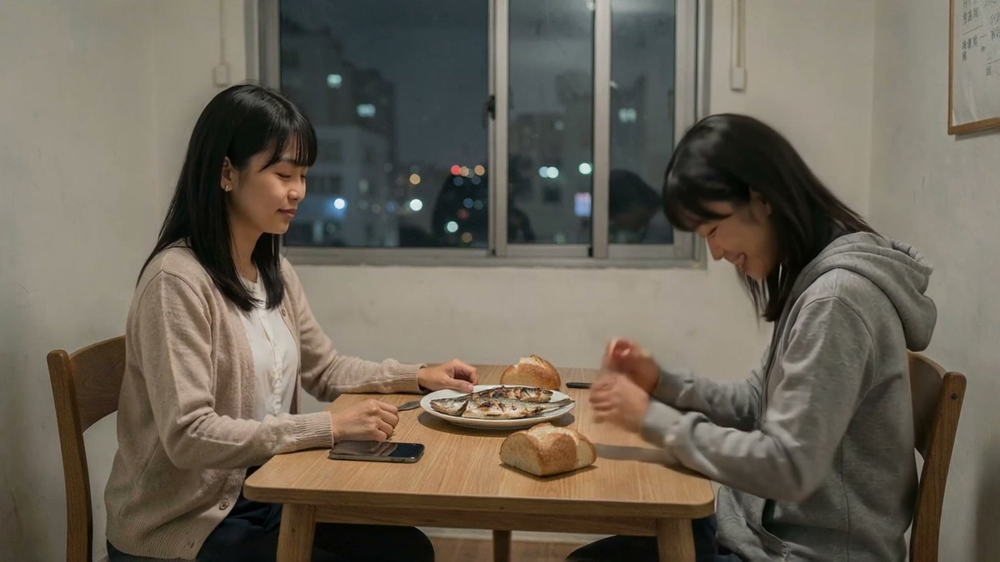*AI 生成*

食物有時是身份的標記，潔淨規範有時形成社會的邊界，但耶穌卻常常坐在邊界上，邀請人過來。

或許，這才是我們今天回頭看第一世紀猶太餐桌，最值得思考的事情。

---

## 參考資料與考據附註

### 一、聖經經文

- 約翰福音二章1–11節：迦拿婚宴。
    
- 馬太福音十四章、馬可福音六章、路加福音九章：五餅二魚。
    
- 馬可福音七章1–23節、馬太福音十五章1–20節：洗手與潔淨爭論。
    
- 路加福音七章、十四章：耶穌與人同桌的社會意義。
    
- 使徒行傳十至十一章、十五章：外邦人和飲食律的後續討論。
    
- 利未記十一章、申命記十四章：飲食律核心。
    
- 申命記八章8節：七種土產。
    
- 馬太福音二十章：葡萄園工人的日薪參照。
    
- 創世記十八章：亞伯拉罕接待客人。
    

### 二、研究與考古

- Jodi Magness，《Stone and Dung, Oil and Spit》：第二聖殿時期猶太人的日常生活、潔淨與考古。
    
- Jordan D. Rosenblum，《The Jewish Dietary Laws in the Ancient World》：古代猶太飲食律的發展與實踐。
    
- K. C. Hanson 與 Douglas E. Oakman，《Palestine in the Time of Jesus》：耶穌時代的社會結構與經濟。
    
- K. C. Hanson 的加利利漁業研究。
    
- David A. Fiensy 與 Ralph K. Hawkins 編，《The Galilean Economy in the Time of Jesus》：加利利經濟與社會研究。
    
- Susan Weingarten，〈Biblical Archaeology 101: The Ancient Diet of Roman Palestine〉，Biblical Archaeology Review 2019 年 3/4 月號：羅馬時期巴勒斯坦的日常飲食；學者估計麵包約佔一般人每日熱量的 50～75%。
    

考古上，第一世紀猶太聚落的豬骨比例通常較低，支持飲食律在當時確實受到遵守；石製器皿與浸禮池的考古發現，也反映潔淨觀念在部分猶太社群日常生活中的重要性。

但這些是特定聚落的考古證據，不能直接推論整個地區所有人的生活方式。

### 三、婚宴與招待

- 約翰福音二章：六口石缸及其容量。
    
- 後期拉比文獻：婚宴與七天慶祝的相關傳統。
    
- 創世記十八章：古代近東好客傳統的經典故事。
    
- 福音書中的洗腳、抹油和宴席場景：理解第一世紀招待文化的參考。
    

### 四、古今飲食比較

現代地中海飲食是二十世紀逐漸建立的健康飲食模式，有大量流行病學與臨床研究支持其健康益處。

古代猶太飲食則以穀物、豆類、橄欖油、蔬果為重要組成，動物性食物的取得受到地區、階級、季節和經濟條件影響。

兩者有相似的食材，但不能視為同一套飲食模式。

**考據提醒：** 第一世紀資料、後期拉比文獻與現代研究應分開理解。不同地區、階級和季節的生活條件差異很大，本文呈現的是一般生活輪廓，不代表每個猶太家庭都完全相同。