> 這篇也有影片版：[關於聖誕節的三個流言！｜穿越聖經時代 SP2](https://youtu.be/PTGroJ37hl0)（[穿越聖經時代 播放清單](https://www.youtube.com/playlist?list=PLbeYmaJdz79U)，每週二更新）

每年一到十二月，台灣街頭就開始出現聖誕樹、交換禮物派對、百貨公司燈飾，還有一位穿著紅衣服、工作量明顯違反勞基法的白鬍子老先生。

*AI 生成*

但你可能聽過這樣的疑問：

「聖經沒寫耶穌的生日，12 月 25 日到底是誰的生日？是耶穌，還是羅馬的太陽神？」

這個疑問有一部分歷史背景，但答案沒有那麼簡單。

因為關於 12 月 25 日的由來，歷史學界至今仍有不同解釋。而且，今天大家搶著慶祝的聖誕節，歷史上居然曾經被部分基督徒掌權的政權立法禁止。

至於聖誕老人，很多人以為他是可口可樂發明的，這個說法也不對。

一個紀念耶穌降生的宗教節日，究竟如何與古代羅馬的冬季文化相遇，經歷清教徒的抵制、維多利亞時代的家庭文化轉變，最後成為現代全球最重要的商業節慶之一？

這段歷史，比我們想像的精彩得多。

---

## 一、12 月 25 日，到底是誰選的？

先講一件確定的事：**聖經的確沒有記載耶穌確切的出生日期。**

《路加福音》告訴我們，耶穌出生時，有牧羊人在野地看守羊群；《馬太福音》則記載東方博士前來朝拜的故事。

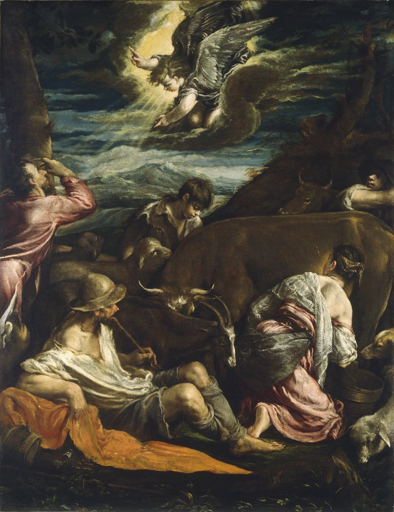*雅各布．巴薩諾（傳）〈天使報喜給牧羊人〉，約 1555–1560 年，美國國家藝廊。CC0，經 Wikimedia Commons（[原檔](https://commons.wikimedia.org/wiki/File:Jacopo_Bassano,_The_Annunciation_to_the_Shepherds,_probably_1555-1560,_NGA_267.jpg)，已縮小）*

但兩卷福音書都沒有告訴我們，耶穌究竟出生在幾月幾日。

早期基督徒也沒有一開始就慶祝耶穌的生日。他們更重視耶穌的受難與復活。例如三世紀的教父俄利根，甚至嘲諷羅馬人慶祝生日的習俗，認為那是異教的做法。

那麼，12 月 25 日是怎麼冒出來的？

這裡有兩條重要的歷史線索。

### 第一條線索：羅馬人的冬季節慶

古代羅馬人在十二月有一個重要節日，叫作農神節（Saturnalia）。

農神節通常從 12 月 17 日開始，後來可以延續好幾天。人們宴飲、交換禮物，甚至暫時放下平常的社會秩序。

聽起來是不是有點像現代公司的尾牙？

只不過羅馬人的尾牙，可能比老闆喝醉後上台唱歌還要失控。

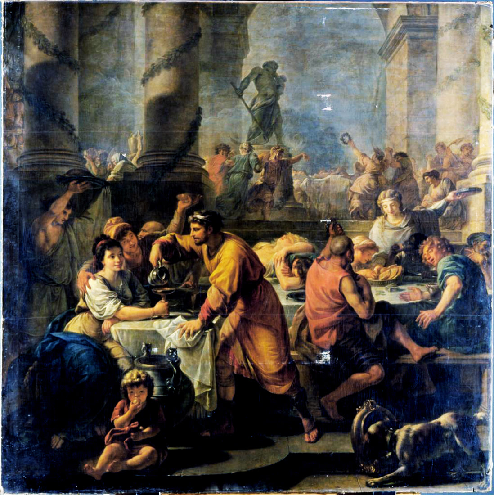*安托萬－法蘭索瓦．卡萊〈農神節〉，1783 年，羅浮宮。CC0，經 Wikimedia Commons（[原檔](https://commons.wikimedia.org/wiki/File:Saturnalia_by_Antoine_Callet.jpg)，已縮小）*

除了農神節，羅馬世界也有對太陽神的崇拜。

公元 274 年，羅馬皇帝奧勒良（Aurelian）大力推崇「無敵太陽神」（Sol Invictus）。

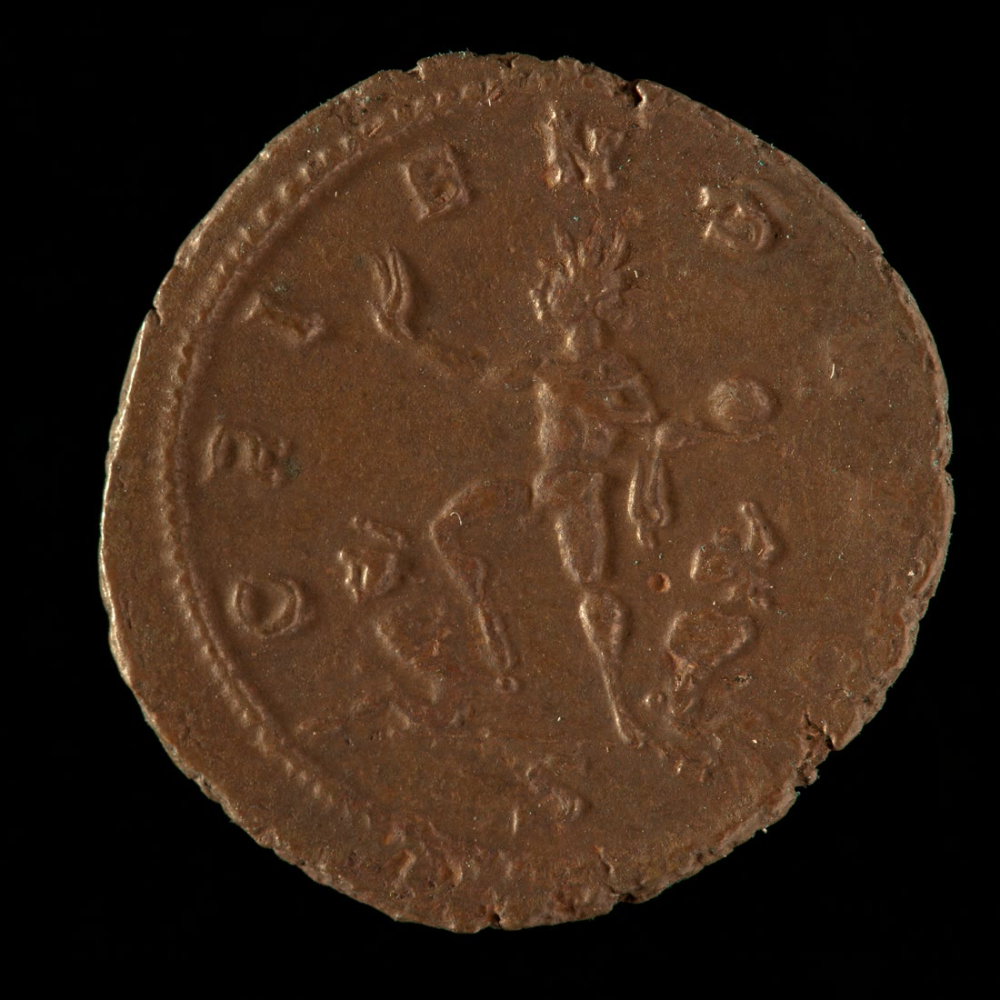*奧勒良安東尼尼安幣背面〈ORIENS AVG〉太陽神索爾，270–275 年，泰勒斯博物館。CC0，經 Wikimedia Commons（[原檔](https://commons.wikimedia.org/wiki/File:Antoninianus,_Rome_en_Mediolanum,_Aurelianus,_Romeins_keizerrijk_270-275_barcode_800000087065_(2).jpg)，已縮小）*

於是，網路上就出現了一個非常流行的故事：

皇帝把 12 月 25 日定為太陽神的生日，後來基督徒才在同一天紀念耶穌降生。

但其實歷史證據沒有這麼完整。

我們知道奧勒良推崇太陽神，但沒有足夠直接的當代證據，可以確定他在 274 年就正式把 12 月 25 日定為太陽神的生日。研究羅馬太陽崇拜的學者 Steven Hijmans 指出，「奧勒良設立這個節日」的說法無法證明，甚至沒有確切證據顯示，12 月 25 日的太陽神節日比聖誕節更早出現。

現存最早把 12 月 25 日和「無敵者的誕辰」（Natalis Invicti，學者多認為指的是太陽神）寫在一起的文獻，是公元 354 年的《羅馬年鑑》（Chronograph of 354）。同一份年鑑也記載基督在 12 月 25 日生於伯利恆，這部分的曆法資料，學者推定可以追溯到公元 336 年左右。

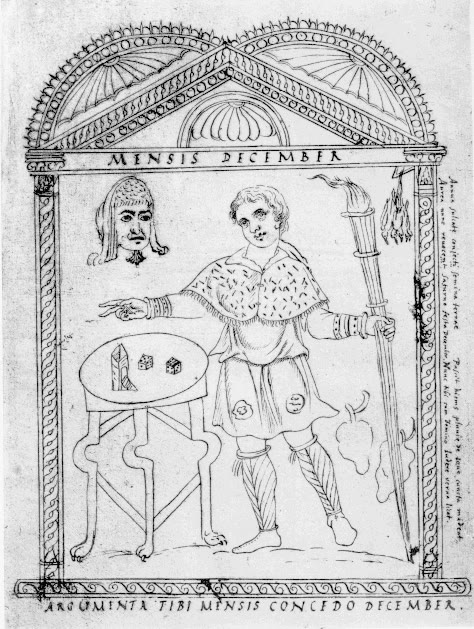*《354 年羅馬年鑑》十二月曆頁（菲洛卡魯斯原作，17 世紀抄本）。公有領域，經 Wikimedia Commons（[原檔](https://commons.wikimedia.org/wiki/File:Chronography_of_354_Mensis_December.png)）*

換句話說，到了第四世紀的羅馬，12 月 25 日已經同時出現在太陽神與基督降生的紀念傳統中。

但這份文獻只能證明兩種紀念都存在，卻不能說明誰先誰後；把兩張日期相同的行事曆放在一起，看不出是誰影響了誰。

更何況，農神節、冬至與無敵太陽神的慶典，雖然都與羅馬的冬季文化有關，卻不是完全相同的節日。

### 第二條線索：早期基督徒自己的日期計算

另一種解釋，則來自早期基督徒的神學推算，通常被稱為「計算說」（Calculation Theory）。

這個說法源自古代的一種觀念：偉大先知的生命是「完整」的，他離世的日子，會和他出生或受孕的日子落在一年中的同一天。套用在耶穌身上，就是祂「生命開始（受孕）」與「生命結束（受難）」落在同一天。

根據這種算法，早期神學家推算出耶穌在 3 月 25 日受難，便以此反推，認定祂當年也是在 3 月 25 日受孕的；從這一天往後推算九個月的懷胎期，耶穌的誕生日剛好就落在 12 月 25 日。

這個推算與部分早期基督教作者對救贖歷史及日期象徵的理解有關，並不是聖經直接提供的出生日期。

研究早期基督教的學者 Andrew McGowan 曾詳細介紹這種解釋，並認為 12 月 25 日「不太可能只是為了配合異教的太陽節而選的日子」。不過，也有學者質疑早期教父是否真的這樣推算。

所以，12 月 25 日究竟是受羅馬節慶影響，還是基督徒自己推算出來的？

目前史學家仍無法把這個問題完全定案。

羅馬世界原本就熟悉冬季、太陽與光明的象徵；早期基督徒也有自己的神學日期推算。兩者可能在後來的文化中彼此影響，但不能把這種可能性直接講成已經證實的歷史。

不過，有一件事很有意思。

《約翰福音》把耶穌描述為照亮世界的真光，對基督徒而言，光明不只是自然界的太陽，更具有救贖與盼望的意義。

**因此，不管 12 月 25 日最初是如何被選中的，後來的基督教文化確實賦予了冬季與光明意象新的意義。**

---

## 二、聖誕節居然曾經是違法活動？

如果你以為聖誕節從古至今，都是一家人坐在壁爐前面，喝熱可可、唱聖誕歌，那就太小看歷史了。

在中世紀的英格蘭，聖誕節除了宗教禮拜，也有長達十二天的熱鬧民間活動，宴飲、喝酒、唱歌、狂歡都很常見。

總之，當時的聖誕節，有時更像一場大型社區狂歡，而不是安靜的家庭聚會。

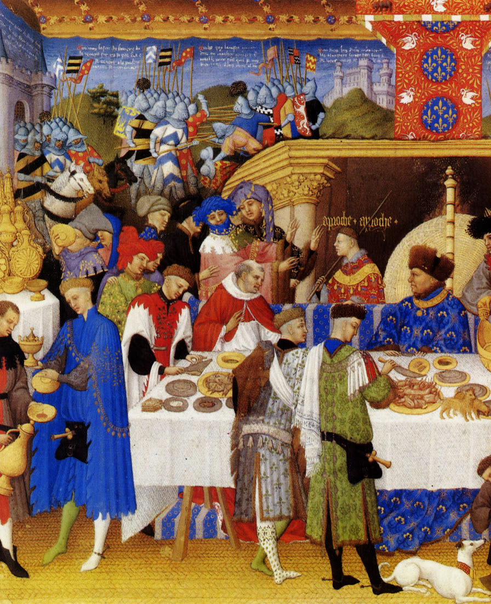*林堡兄弟《貝里公爵的豪華時禱書》〈一月〉，1411–1416 年，孔代博物館。公有領域，經 Wikimedia Commons（[原檔](https://commons.wikimedia.org/wiki/File:Les_Tr%C3%A8s_Riches_Heures_du_duc_de_Berry_Janvier-2.jpg)，已縮小）*

然後，到了十七世紀，英格蘭出現了一群很不喜歡這種氣氛的人：清教徒。

他們認為，聖經沒有命令基督徒必須慶祝耶穌的生日，而且當時的聖誕節充滿迷信、放縱與不合宜的習俗。

1647 年 6 月 8 日，英格蘭長期議會通過《廢除節日條例》（An Ordinance for Abolishing of Festivals），不再將聖誕節等傳統節日作為宗教節日慶祝；這些限制，直到 1660 年王政復辟後才告終。

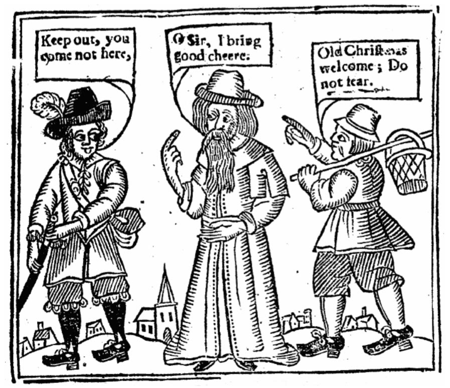*禁令期間出版的小冊：約翰．泰勒《為聖誕節辯護》（The Vindication of Christmas）卷首木刻，1652 年。公有領域，經 Wikimedia Commons（[原檔](https://commons.wikimedia.org/wiki/File:Frontispiece_to_%27%27The_Vindication_of_Christmas%27%27_by_John_Taylor,_1652.png)）*

但更精彩的故事，發生在北美的清教徒。

### 1659 年：過聖誕節，罰五先令

1659 年，麻薩諸塞灣殖民地通過了一項法律，禁止以停止工作、設宴或其他方式慶祝聖誕節。

違反規定的人，每次可以被罰五先令。

你沒有看錯。

今天你可能因為聖誕節沒有放假而抱怨老闆；但在十七世紀的麻薩諸塞，你可能因為聖誕節放假而被政府罰錢。

這項禁令直到 1681 年才被廢除。

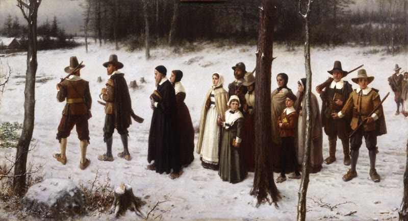*喬治．亨利．鮑頓〈清教徒上教堂〉，1867 年，紐約歷史學會。公有領域，經 Wikimedia Commons（[原檔](https://commons.wikimedia.org/wiki/File:George-Henry-Boughton-Pilgrims-Going-To-Church.jpg)）*

這段歷史最值得深思的地方是：

**當時反對聖誕節的人，不是反對基督教的人，反而是一群非常重視基督教信仰的人。**

他們不是不相信耶穌，而是認為這種慶祝方式缺乏聖經根據，甚至可能讓人偏離信仰。

因此，今天我們常問：「聖誕節是不是太世俗了？」

其實三百多年前，已經有基督徒在問類似的問題。

只是他們的解決方法比較激烈：乾脆不要過！

> **小知識：麻薩諸塞灣殖民地（Massachusetts Bay Colony）**
>
> - 建立者是英國清教徒，他們為了擺脫英國國教的限制、實踐自身嚴格的宗教理想而移民至此，建立了一個政教合一色彩濃厚的社會。
> - 它與鄰近的普利茅斯殖民地（五月花號登陸地）後來合併，成為美國獨立運動的重要發源地。

---

## 三、誰把聖誕節變成溫馨家庭節日？

那麼，聖誕節是什麼時候開始變成我們今天熟悉的樣子？

答案很大一部分，要回到十九世紀，特別是英國的維多利亞時代。

隨著家庭文化、印刷媒體與城市消費生活的發展，聖誕節開始被塑造成一個強調家庭、孩子、慈善與團聚的節日。

1848 年，《倫敦新聞畫報》（Illustrated London News）刊登了維多利亞女王與亞伯特親王一家圍繞聖誕樹的插畫。

這幅圖像廣泛流傳，讓聖誕樹與溫馨家庭生活產生更強烈的連結。

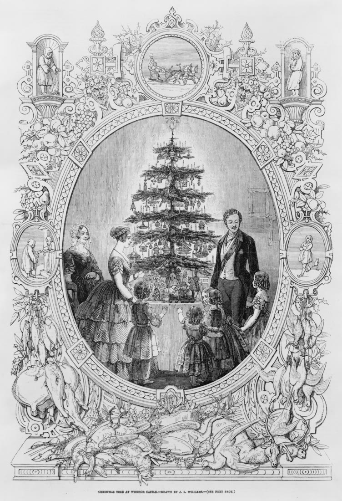*《倫敦新聞畫報》〈溫莎城堡的聖誕樹〉，1848 年。公有領域，經美國國會圖書館（[原檔](https://www.loc.gov/pictures/item/96522234/)，已縮小）*

而作家狄更斯（Charles Dickens）在 1843 年出版的《小氣財神》（A Christmas Carol），更讓聖誕節成為一個關於同情、悔改、慈善與人際和解的故事。

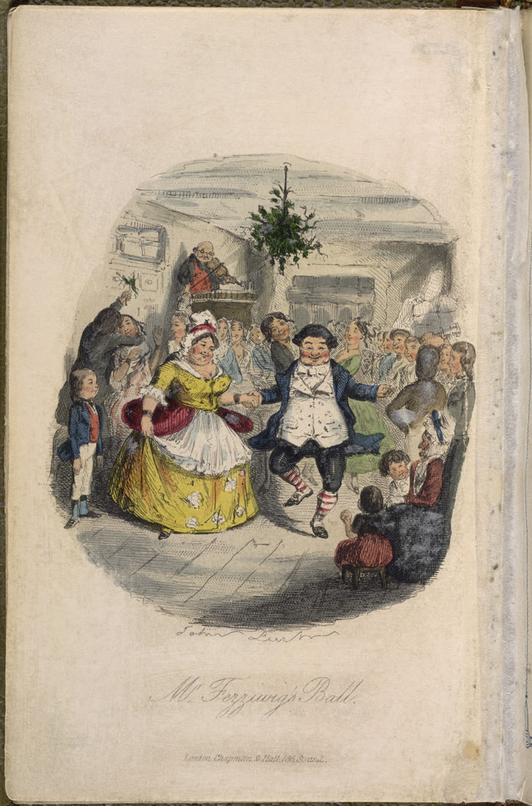*約翰．里奇〈費茲威格先生的舞會〉，《小氣財神》初版卷首插畫，1843 年，大英圖書館。CC0，經 Wikimedia Commons（[原檔](https://commons.wikimedia.org/wiki/File:Mr_Fezziwig%27s_Ball_-_A_Christmas_Carol_(1843),_frontispiece_-_BL.jpg)，已縮小）*

這些觀念不是維多利亞時代憑空發明的。

但透過文學、報紙、插畫與家庭文化，它們變得比以前更普及。

你可以說，十九世紀幫聖誕節做了一次非常成功的品牌改造。

從熱鬧到可能失控的公共節慶，逐漸轉變成強調家庭團聚、孩子笑容與溫暖壁爐的節日。

### 聖誕老人：一位經歷數百年品牌改造的老先生

那麼，聖誕老人又是誰設計的？

這位老先生的履歷，其實比你想像中複雜。

他的歷史原型之一，是相傳曾任古代小亞細亞米拉城主教的聖尼古拉（Saint Nicholas）。傳統故事把他描繪成一位慷慨助人、特別關懷窮人與孩子的人物。

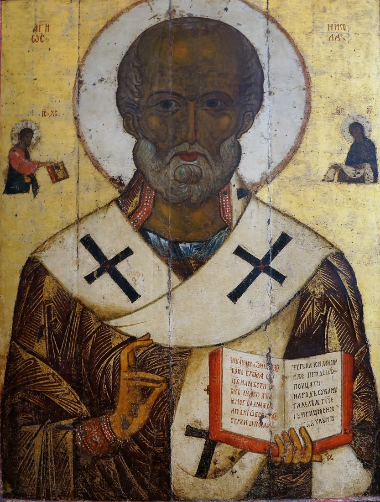*〈聖尼古拉〉俄羅斯聖像，特列季亞科夫美術館。公有領域，經 Wikimedia Commons（[原檔](https://commons.wikimedia.org/wiki/File:Ic%C3%B4ne_de_Saint-Nicolas,_galerie_Tretiakov.-_Moscou,.jpg)，已縮小）*

後來，這個形象經過荷蘭的 Sinterklaas 傳統，再進入美國的詩歌、民間故事與插畫文化，才逐漸變成我們熟悉的 Santa Claus。

到了十九世紀，美國插畫家 Thomas Nast 對聖誕老人的視覺形象產生了重要影響。

1881 年 1 月 1 日出刊的《Harper's Weekly》，刊出了他著名的《Merry Old Santa Claus》（原刊是黑白木刻）。

這幅插畫裡的聖誕老人，已經有白鬍子、圓滾滾的身材、親切又帶點調皮的表情。

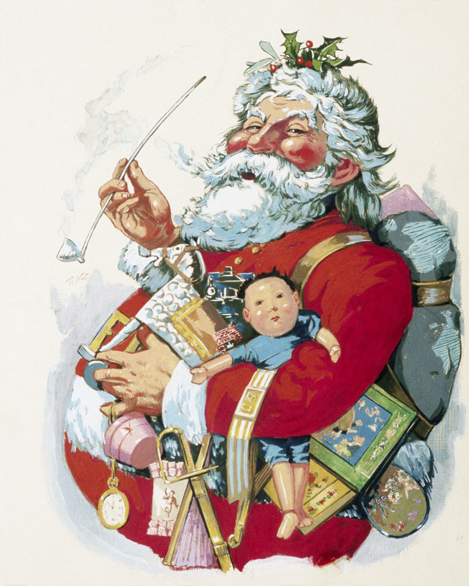*湯瑪斯．納斯特〈Merry Old Santa Claus〉，1881 年（後人上色版）。公有領域，經 Wikimedia Commons（[原檔](https://commons.wikimedia.org/wiki/File:MerryOldSanta.jpg)，已縮小）*

是不是已經很像今天的聖誕老人？

更有趣的是，這幅插畫出現於 1881 年，而可口可樂直到 1886 年才問世。

**所以，聖誕老人當然不是可口可樂發明的。**

### 從 Thomas Nast 到可口可樂：不是發明，而是普及

到了 1931 年，可口可樂委託插畫家 Haddon Sundblom 創作聖誕老人廣告。

這個版本是不是更熟悉了？紅色外套、白色鬍鬚、圓滾滾的肚子，還有那種看起來非常開心、彷彿剛喝完一瓶可樂的笑容。

所以，紅衣聖誕老人早就存在，可口可樂並沒有發明他的衣服顏色，也不是聖誕老人的發明者，但透過 1931 年至 1964 年間持續推出的系列廣告，Sundblom 筆下溫暖、快樂、充滿人性特徵的聖誕老人，變得更加普及，也逐漸成為現代商業聖誕節最容易辨認的符號之一。

從聖尼古拉到 Thomas Nast，再到可口可樂，這位老先生經過了好幾個世紀的形象更新。

如果聖誕老人真的有履歷表，他大概會寫：

- 跨國文化整合經驗：數百年。
- 品牌代言經驗：全球。
- 物流管理能力：每年一天完成全球配送。

而這種商業力量，到今天仍然非常驚人。

根據美國零售聯合會（NRF）2026 年 10 月發布的預測，美國十一月至十二月的假期零售銷售額，預計達到 1.013 兆美元，年增約 4.2%。

*AI 生成*

這雖然不是聖誕節單一天的消費，而是整個年終假期購物季，但它仍然說明了一件事：

一個原本用來紀念宗教事件的節日，如今也成為全球商業文化中非常重要的一部分。

---

## 四、來到台灣，為什麼變成「耶誕節」？

聖誕節傳到台灣以後，又發展出自己的文化特色。

首先，你可能注意到一個有趣的現象：台灣許多官方活動會寫「耶誕節」，而不是「聖誕節」，例如「新北歡樂耶誕城」；但我們平常講話，仍然常說「聖誕快樂」。

這與台灣過去的政治與文化環境有關。

一種常見的歷史解釋是，蔣介石執政時期，主管機關曾主張將「聖誕節」改稱「耶誕節」；據相關報導整理，當時的理由涉及對中華文化「聖人」稱謂的理解，認為孔子、孟子等人物屬於這個傳統，而耶穌不屬於同一文化脈絡，因此傾向使用「耶誕」。

不過，這只是名稱演變的一種解釋，並不代表「聖誕」因此消失，也不能完全歸因於單一政策。直到今天，「聖誕」與「耶誕」在台灣依然並存。而且台灣雖然沒有歐洲那種雪白的街景，卻很擅長用大量 LED 燈，營造出一種彷彿下一秒就會下雪的浪漫氣氛。

不過台灣的 12 月 25 日，還有另一個身分：**行憲紀念日。**

1947 年 12 月 25 日，《中華民國憲法》正式施行。

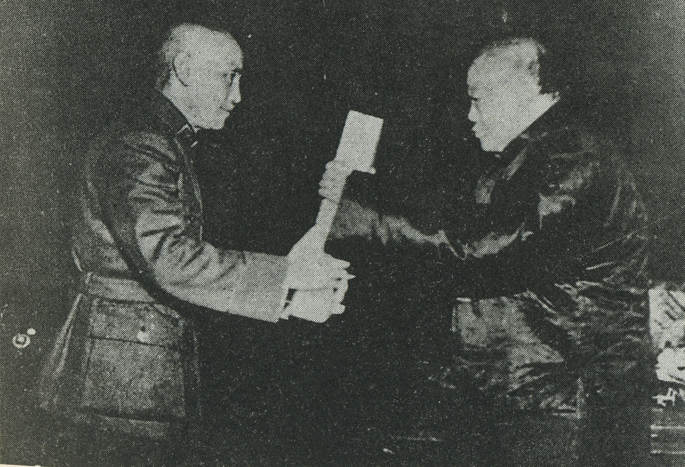*制憲國民大會主席吳敬恆呈遞《中華民國憲法》，1946 年 12 月 25 日（憲法在這天三讀通過，隔年同一天施行）。公有領域，經 Wikimedia Commons（[原檔](https://commons.wikimedia.org/wiki/File:Delivering_ceremony_of_the_Constitution_of_ROC_1946.jpg)）*

行憲紀念日從 1963 年起放假，2001 年起配合週休二日改成只紀念、不放假；直到 2025 年 5 月 28 日公布的《紀念日及節日實施條例》，才又將它列為放假一日的紀念日。

也就是說，2026 年的 12 月 25 日是星期五，政府機關從 12 月 25 日連放到 27 日（民間企業依勞動部規定）。只是法律上的放假理由，不是慶祝耶穌出生，而是紀念憲法施行。

同一個日期，竟然可以同時有宗教、政治與商業三種不同的意義。

這真的很符合台灣的風格：白天享受行憲紀念日的假期，晚上去看耶誕城燈飾，回家再參加教會的聖誕聚會。

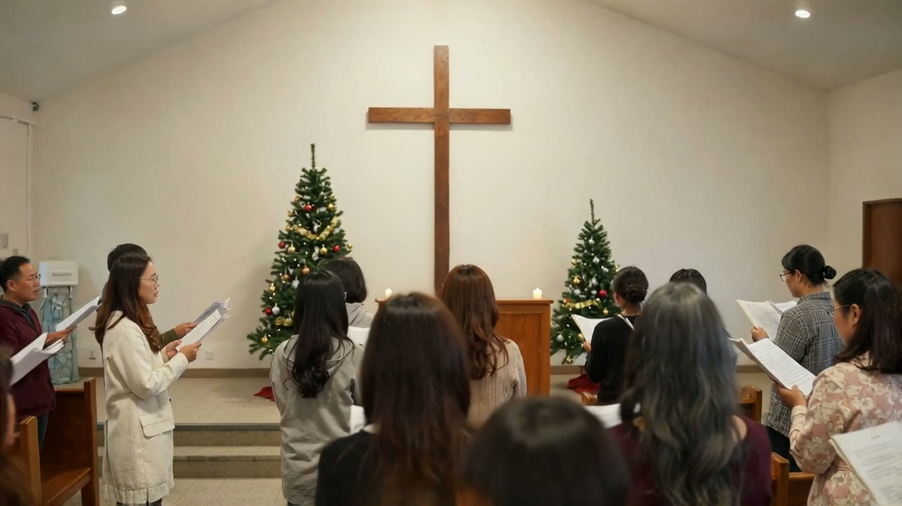*AI 生成*

一個日期，三種用途，但同時存在。

---

## 五、聖誕節：集體情緒的容器，與不變的信仰核心

回顧聖誕節的歷史，一個節日，往往不只有一種意義。

羅馬世界有冬季與光明的象徵，早期基督徒紀念基督降生，清教徒曾經想把聖誕節從宗教生活中拿掉，維多利亞時代又把家庭與慈善放到舞台中央。

到了現代，聖誕節還裝進了禮物、戀愛、假期，以及百貨公司的年度業績。

所以，聖誕節很像一個 **「集體情緒的容器」**。不同時代的人，都會把自己最重視的東西放進去：有人放進家庭與童年回憶，有人放進愛情與購物清單，也有人只希望年底能夠好好休息幾天。

看到這裡，可能有人會問：既然聖經沒有記載耶穌真正的生日，聖誕節又有這麼多歷史與商業因素，那基督徒到底應不應該慶祝？

其實，不同基督教傳統有不同的看法。有些基督徒認為聖經沒有命令，不應將這一天視為必須遵守的宗教節日；但也有許多教會非常重視聖誕節，將它視為紀念基督降生、敬拜上帝與關懷他人的重要時刻。

### 將臨期：宗教的等待，與商業的搶跑

在許多遵守教會年曆的傳統裡，聖誕節之前，還有一段特別的時間，叫作「將臨期」（Advent）。

這是一段等待、反省與預備迎接基督降生的日子，也提醒信徒盼望基督再來。

*AI 生成*

但現代商業文化的節奏，剛好相反。教會年曆提醒人們：等待也是信仰生活的一部分；百貨公司則希望你最好十一月就開始買聖誕禮物。

商業不一定會毀掉節日，它只是很擅長把人們本來就有的渴望，包裝成可以購買的形狀：我們想表達愛，於是有了禮物；想感受溫暖，於是有了燈飾與聚會。購買禮物不一定是壞事，家庭聚餐也不是問題。

真正值得思考的，是我們在忙著購物、交換禮物與參加派對的時候，有沒有忘記這個節日原本所指向的核心。

對基督徒而言，12 月 25 日究竟是不是耶穌真正的生日，其實不是信仰的重點。**重要的不是日期有沒有算對，而是這個節日究竟在紀念誰。**

**如果聖誕節是紀念基督降生，那麼它所指向的，不只是歡樂的節慶氣氛，也包含上帝對人的愛，以及基督進入人類歷史的信仰宣告。**

**而這個意義，並不取決於我們是否知道耶穌確切的出生日期。**

---

## 參考資料

### 一、12 月 25 日的起源與早期基督教

1. Andrew McGowan, "How December 25 Became Christmas," *Bible History Daily*, Biblical Archaeology Society. [連結](https://www.biblicalarchaeology.org/daily/people-cultures-in-the-bible/jesus-historical-jesus/how-december-25-became-christmas/)
2. Steven E. Hijmans, "Sol Invictus, the Winter Solstice, and the Origins of Christmas," *Mouseion* 47.3 (2003): 377–398.
3. Encyclopaedia Britannica, "Christmas." [連結](https://www.britannica.com/topic/Christmas)
4. Encyclopaedia Britannica, "Saturnalia." [連結](https://www.britannica.com/topic/Saturnalia-Roman-festival)
5. *Chronograph of 354*（公元 354 年羅馬年鑑）。關於 12 月 25 日的早期曆法記錄，可參考 McGowan 的文獻討論。
6. 《聖經》和合本：《馬太福音》第 1–2 章、《路加福音》第 1–2 章、《約翰福音》1:1–14、8:12。

### 二、清教徒與聖誕節禁令

7. Library of Congress, "Christmastime in England: Prohibitions and Permissions." [連結](https://blogs.loc.gov/law/2017/12/christmastime-in-england-prohibitions-and-permissions/)
8. Commonwealth of Massachusetts, "Massachusetts Law Banning Christmas." [連結](https://www.mass.gov/news/massachusetts-law-banning-christmas)
9. Mass Moments, "Christmas Celebration Outlawed"（1681 年廢除）. [連結](https://www.massmoments.org/moment-details/christmas-celebration-outlawed.html)

### 三、維多利亞時代與聖誕老人

10. Charles Dickens, *A Christmas Carol*, 1843。
11. *The Illustrated London News*, "Christmas Tree at Windsor Castle," 1848。
12. Thomas Nast, "Merry Old Santa Claus," *Harper's Weekly*, 1881。[連結](https://commons.wikimedia.org/wiki/File:Merry_Old_Santa_Claus,_by_Thomas_Nast,_1881.jpg)
13. The Coca-Cola Company, "Haddon Sundblom and the Coca-Cola Santas." [連結](https://www.coca-colacompany.com/about-us/history/haddon-sundblom-and-the-coca-cola-santas)
14. Smithsonian National Museum of American History, "How Santa Brought Coca-Cola in from the Cold." [連結](https://americanhistory.si.edu/explore/stories/how-santa-brought-coca-cola-cold)
15. National Geographic, "The History of How St. Nicholas Became Santa Claus." [連結](https://www.nationalgeographic.com/history/article/131219-santa-claus-origin-history-christmas-facts-st-nicholas)
16. National Retail Federation, "NRF Forecasts 2026 Holiday Sales Growth as Consumers Remain Resilient." [連結](https://nrf.com/media-center/press-releases/nrf-forecasts-2026-holiday-sales-growth-as-consumers-remain-resilient)

### 四、台灣的耶誕節與行憲紀念日

17. 威克（台灣媒體人），〈台灣講古：聖誕節為什麼成了耶誕節？〉，BBC News 中文專欄，2017-12-21（註明不代表 BBC 立場）。[連結](https://www.bbc.com/zhongwen/trad/chinese-news-42447115)
18. 聯合報〈報時光〉：提到 1980 年代要求將「聖誕節」改為「耶誕節」，年代說法與上文不同。[連結](https://time.udn.com/udntime/story/122833/8448744)
19. 李孟學，〈基督降誕：臺灣的耶誕節與耶誕圖像〉，典藏 ARTouch，2023-12-21。[連結](https://artouch.com/art-views/content-128064.html)
20. 《中華民國憲法》，1947 年 1 月 1 日公布，同年 12 月 25 日施行。
21. 《紀念日及節日實施條例》，2025 年公布，將行憲紀念日列為應放假一日的國定紀念日。
22. 行政院人事行政總處，2026 年政府行政機關辦公日曆。[連結](https://www.dgpa.gov.tw/)

### 五、基督徒對聖誕節的不同觀點

23. GotQuestions.org, "Should Christians Celebrate Christmas?" [連結](https://www.gotquestions.org/Christian-Christmas.html)
24. Clare Coffey, "People Always Ruin Christmas," *Christianity Today*, 2025-11-05. [連結](https://www.christianitytoday.com/2025/11/people-always-ruin-christmas/)

*本文整理自聖經經文、歷史文獻、學術研究與公開資料。部分歷史問題仍存在不同學術解釋，文中盡量區分可確認的史實、歷史推論與作者觀點。*
